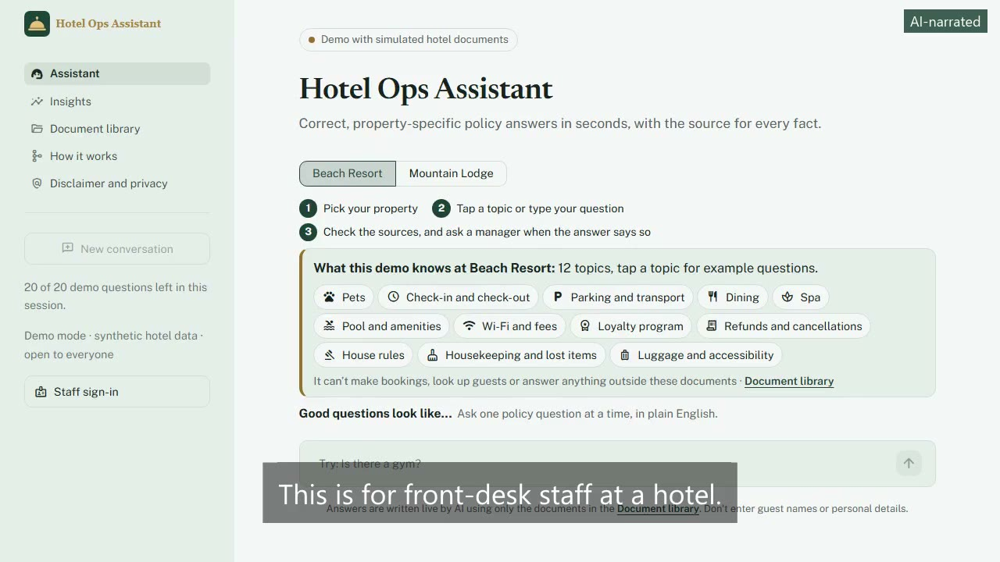
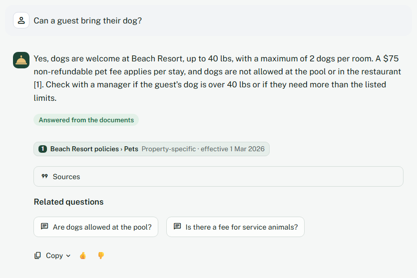
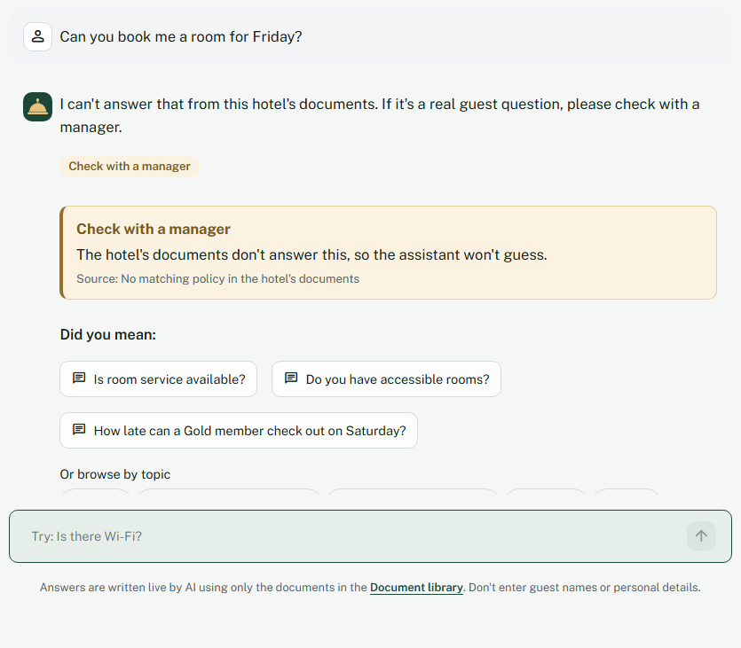
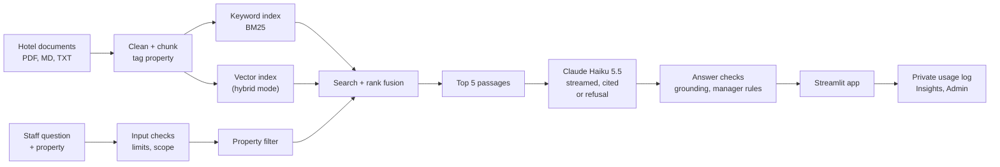
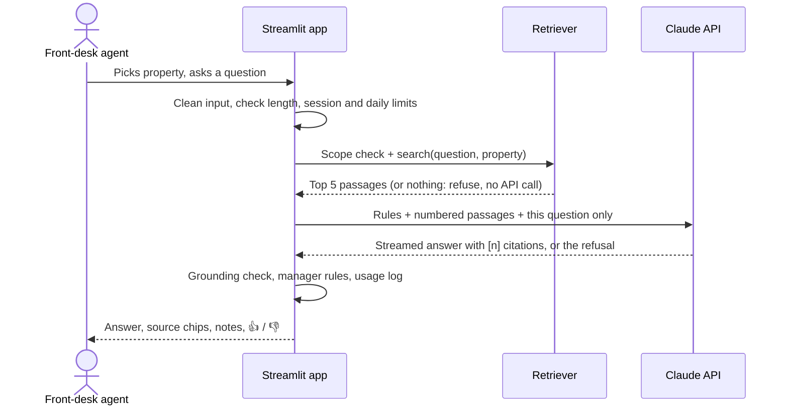
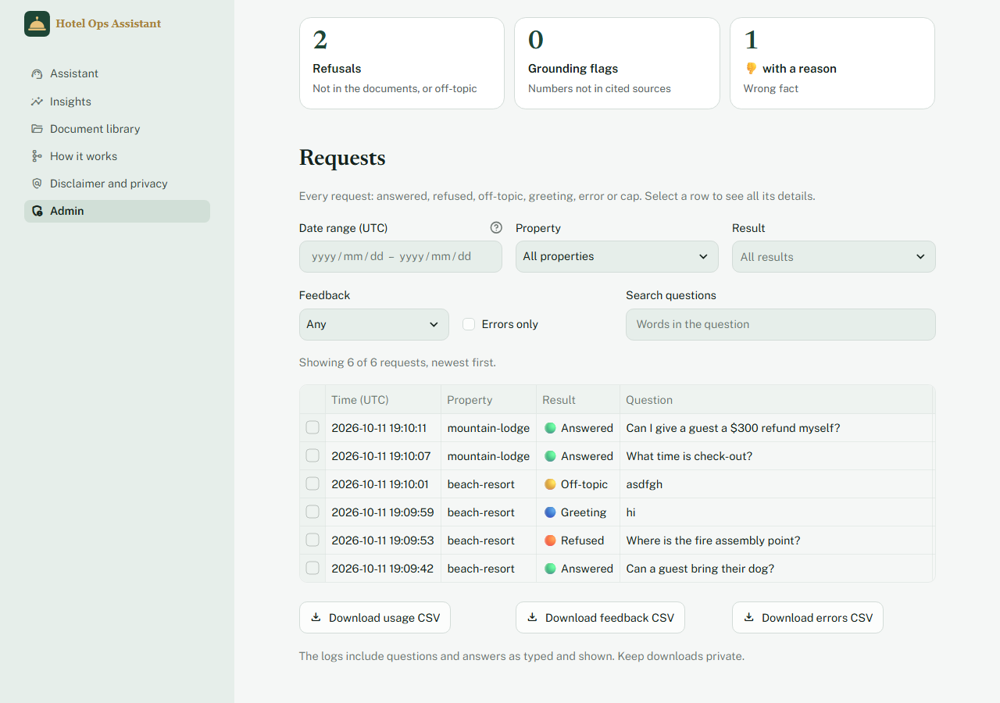
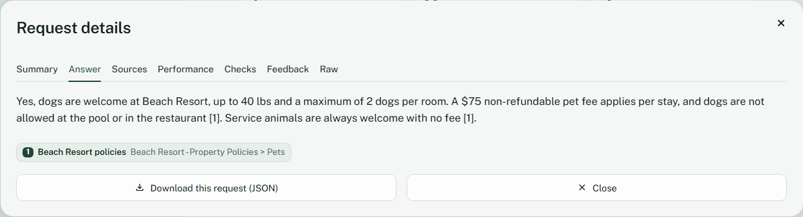
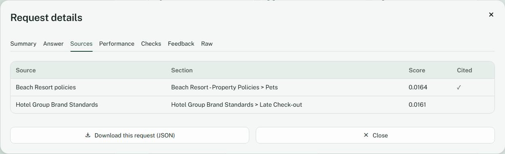

# 🛎️ Hotel Operations Knowledge Assistant

[](https://github.com/vamsialladev/hotel-ops-assistant/actions/workflows/ci.yml)


[](https://hotel-ops-assistant.streamlit.app)

**An AI assistant that gives hotel front-desk staff correct, property-specific policy answers in seconds, with the source for every fact.**

> **Stage 1 of a simulated client engagement** for a fictional hotel group with two properties, a beach resort and a mountain lodge. All documents are synthetic and written to mirror real hotel operations. Business value is a projection from stated assumptions, not a measured result. Discovery and scoping (stage 0): [hotel-ai-discovery](https://github.com/vamsialladev/hotel-ai-discovery).

<!-- DEMO-VIDEO -->
<!-- AI-NARRATED-DEMO:START -->
<a href="docs/video/demo-ai-voice.mp4"></a>

**Demo video (1:13, AI-narrated):** [watch the MP4](docs/video/demo-ai-voice.mp4) · captions burned in ([text](docs/video/demo-ai-voice.srt)). The narrator is an AI voice (Kokoro); my own-voice version will replace it.
<!-- AI-NARRATED-DEMO:END -->

<p align="center"></p>
<p align="center"><em>The live app: one click on a suggested question, a cited answer from the hotel's own policy in about two seconds.</em></p>

**▶ Try it live: [hotel-ops-assistant.streamlit.app](https://hotel-ops-assistant.streamlit.app)** (open to everyone, no sign-in). Free hosting: may take ~30 s to wake.

📄 **[Case study](https://vamsialla.com/projects/hotel-ops-assistant.html)** · 💰 **[Business case](docs/BUSINESS_CASE.md)** · 🏗️ **[Architecture](docs/ARCHITECTURE.md)** · 🧭 **[Decisions](docs/DECISIONS.md)**

---

## At a glance

| | |
|---|---|
| **Problem** | Staff search scattered PDFs, menus and notes while a guest waits, and the rules differ by hotel. Wrong answers turn into refunds and complaints. |
| **Solution** | Pick your property, ask in plain English, and get a 1–4 sentence answer that cites every fact. It refuses when the documents don't say, corrects wrong facts in the question, and points to a manager for refunds and safety. |
| **Quality (measured)** | 54-question eval, 3 runs, live demo's keyword-only search: **100% answer accuracy** in v1.6.0 (98% in v1.5.0; hybrid 97% in v1.5.0); 100% of escalation rules correct; full answer p95 **2.9s**. Held-out questions added later: 67% → 85% after the stage 4 (production) fixes (Spanish, emergencies). **First-question success 100%** on 49 questions a visitor types first (43% before the coverage work). 378 tests, 97% coverage. |
| **Cost (measured)** | **$0.18 per 1,000 questions** (v1.6.0 release run, Claude Haiku 5.5, 3 runs) |
| **Projected value** | ~$32K/yr net for 2 properties (range $8.5K–$66K); ~$1.6M/yr at 100-property scale ([assumptions](docs/BUSINESS_CASE.md)) |

## Where to start

| If you are a... | Read |
|---|---|
| **Recruiter or hiring manager** | [At a glance](#at-a-glance) → [Results](#results) → [Skills demonstrated](#skills-demonstrated) → [Case study](https://vamsialla.com/projects/hotel-ops-assistant.html) |
| **Hotel manager or operations lead** | [The problem](#the-problem) → [What it does](#what-it-does) → [Business case](docs/BUSINESS_CASE.md) |
| **Engineer** | [Architecture](#architecture) → [Results](#results) → [Run it locally](#run-locally) → [Decision log](docs/DECISIONS.md) |

---

## The problem

A guest at the front desk asks: *"Can I bring my dog?"*

- At the **Beach Resort**, the answer is yes, up to 40 lbs, $75 per stay.
- At the **Mountain Lodge**, it's yes, any size, $50 per night capped at $200.
- An **outdated 2024 document** still on the shared drive says *no pets at all*.

Staff have to find the right document for the right hotel while the guest waits. Multiply that by dozens of questions a day across pets, late checkout, parking, fees, spa, dining and events.

I built this because the front-desk lead at Mountain Lodge told me about the last question they couldn't answer: the early check-in fee was only in the staff notes, so they radioed the night manager and the guest waited about four minutes ([discovery](https://github.com/vamsialladev/hotel-ai-discovery/blob/main/docs/DISCOVERY.md)).

## What it does

| Welcome: how to use, what it knows, topics, good questions | Answer with related questions | Refused, with "Did you mean" |
|---|---|---|
|  |  |  |
| **Cited answer with a property override** | **Same question, different property** | **"Check with a manager", quoting the rule** |
|  |  |  |
| **Refuses instead of guessing** | **Insights: how people ask, topics, gaps** | |
|  |  | |

**For front-desk staff (Assistant page)**
- **Knows what to ask, from the first second:** a "How to use" strip, a "What this demo knows" panel whose topic chips come from the indexed documents, three good-question examples and a rotating "Try: …" hint, on first visit and after every New conversation. Click a suggestion or type your own question.
- **Never a dead end:** related questions under each answer (picked by the topic of the cited section, never repeating one already asked); after a refusal, "Did you mean" questions and topic chips; "hi" or "what can you do?" gets an instant reply with examples (no API call, not counted); gibberish or unrelated questions get a polite scope message with popular questions. Every suggestion comes from a curated list that's tested to get a real answer.
- **Real follow-ups:** "what about at Mountain Lodge?" or "and for Gold members?" work. The latest message is rewritten into one standalone question from the last 3 turns, shown under the answer as "Understood as: …"; retrieval and the answer model see only that question and the passages, never the raw conversation. Naming the other hotel switches the property for that question and the picker follows.
- **Conversations you can come back to and share:** one conversation can span both hotels; "New conversation" keeps the old one in a "Past conversations" list for the browser session, one click reopens it. "Share this conversation" makes a read-only link with the conversation compressed inside the URL (nothing stored on a server); personal details are replaced before the link is made.
- **Cited answers, streamed:** the first words appear in about a second; every fact has a numbered citation, a source chip (document › section, property-specific or brand-wide, effective date) and the quoted text under **Sources**.
- **Refuses rather than guesses**, and refuses off-topic questions before calling the API when nothing in the documents matches.
- **Corrects wrong facts in the question:** "Can a guest bring their dog? (expect $75 per stay)" at Mountain Lodge answers "The $75 per-stay figure isn't correct: the pet fee is $50 per night…".
- **"Check with a manager" notes** for refunds over the front-desk limit, non-refundable rate exceptions, repeated noise complaints and safety questions, each quoting the rule from the documents.
- **Grounding check:** a number that doesn't appear in the cited sources is flagged "Check before quoting".
- **Copy and feedback:** copy the answer; 👍 / 👎 with an optional reason (wrong fact, missing information, wrong property, unclear, other), saved once without re-asking.

**For managers:** **Insights** (questions asked, helpful rate, how people ask (typed vs suggestions), most-used topics, 👎 reasons and suggestions that got a 👎, typed questions the documents couldn't answer as possible policy gaps, known gaps found in the documents) and a **Document library** (every document's status: indexed, superseded and excluded, or scanned and needing OCR, plus the data-quality issues found).

**For recruiters and engineers:** **How it works** reads the latest real eval report (never hard-coded numbers), shows which retrieval mode the running app uses and its measured accuracy, the architecture, the Haiku 4.5 vs 5.5 comparison, and the safety measures.

**For the owner only:** a password-protected **Admin** page (hidden from visitors): health and recent errors, first-question success (live and from the eval), how each question was asked, warnings when the error rate or cost crosses a threshold, questions today against the daily cap, a **request log** listing every request (answered, refused, off-topic, greeting, error, cap) with filters, where selecting a row opens its full details (answer, citations, retrieved passages, timing, cost, checks, feedback, raw JSON), JSONL and CSV downloads of the logs, sign out and a 30-minute auto-lock. See [Monitoring](#monitoring).

<details>
<summary>More screenshots: document library, how it works, dark mode, phone</summary>
<br>

| Document library | How it works |
|---|---|
|  |  |

| Light mode | Dark mode (follows the system setting) | Phone |
|---|---|---|
|  |  |  |
</details>

## Architecture



Full diagrams, components and the scaling path: [docs/ARCHITECTURE.md](docs/ARCHITECTURE.md)

### How a question is answered



**Indexing** (`python -m src.ingest`, whenever documents change)
1. **Load** every `.md`, `.txt` and `.pdf` in `data/raw/<property>/`. The folder is the property tag; `shared/` means brand-wide.
2. **Clean:** skip documents marked `status: superseded`, strip repeated PDF headers and footers, flag scanned pages that have no text.
3. **Chunk** by section heading, keeping the heading path and never splitting a table; staff notes become one chunk per note. Each chunk gets a readable document name and its effective date.
4. **Index** each chunk for keyword search (BM25 with light stemming) and, in hybrid mode, as an embedding.

**Answering** (every question)
1. **Check the input:** strip control characters, enforce 500 characters, the per-session limit and the daily cap.
2. **Scope check:** if nothing in this hotel's documents matches, refuse without calling the API.
3. **Search:** only the selected property plus brand-wide documents; rank by keywords (and meaning, in hybrid mode), fuse with Reciprocal Rank Fusion, keep the top 5.
4. **Generate:** Claude gets the rules, the numbered passages and the question (never earlier turns) and streams a short answer that cites every fact, corrects wrong facts in the question, or refuses.
5. **Check:** numbers must appear in a cited source; refund, safety and complaint rules add a "Check with a manager" note.
6. **Log:** tokens, timing, estimated cost, refusals and grounding flags go to a private, git-ignored log.

## Tech stack

| Layer | Technology | Why |
|---|---|---|
| Language | Python 3.12 | Standard for AI engineering; NumPy 2.5 requires it |
| LLM | Claude Haiku 5.5 (configurable) | Measured: same quality as Haiku 4.5 on this eval at about a fifth of the cost |
| Keyword search | BM25 (`rank-bm25`) + light stemming | Exact terms like prices, airport codes, "valet"; runs on the free cloud tier |
| Semantic search | `sentence-transformers` (MiniLM), optional | Loose phrasing: "jacket" → "lost and found" |
| Rank fusion | Reciprocal Rank Fusion | Combines both rankings without tuning weights |
| PDF parsing | `pypdf` | Text extraction, with custom header/footer removal |
| Web app | Streamlit 1.65 (multi-page, streaming) | Fast, simple staff interface; free hosting |
| Testing | pytest, pytest-cov, Playwright (QA and screenshots) | Unit tests for every piece of logic; scripted UI checks |
| Evaluation | Custom harness | 54 labeled questions, strict retrieval, grounding, refusals, escalation, latency and cost |
| Code quality | Ruff, pre-commit, pip-audit | Clean code, no committed secrets, no known vulnerable dependencies |
| CI/CD | GitHub Actions, Dependabot | Lint, audit, tests with a coverage gate, retrieval regression gate |
| Packaging | Docker (CPU PyTorch) | Always-on hosting with full hybrid search |

## How it handles messy real-world data

| Real-world mess | How it's handled |
|---|---|
| Different rules per hotel | Every chunk tagged with its property; search filtered to that property + brand-wide docs (unit-tested, plus cross-property eval cases) |
| Hotel rule overrides brand rule | The prompt says property rules win, and the answer mentions the override |
| Outdated policy versions | Documents marked `status: superseded` are never indexed (and shown as excluded in the library) |
| Price tables (spa, loyalty tiers) | Section-aware chunking never splits a table |
| Informal staff notes | One chunk per note; a fee that exists only there is listed as a policy gap |
| PDF headers and "Page 1 of 3" footers | Repeated lines removed, with digits masked so changing page numbers still match |
| Scanned image-only PDF | Detected and flagged for OCR instead of indexing garbage; safety questions point to a manager |
| A pasted guest email telling the AI to waive fees | Treated as data, flagged in the document library, and tested on every eval run |
| Word forms, typos, possessives | Light stemming; single-letter tokens (the "s" in "What's") ignored |
| A wrong fact stated in the question | The prompt treats it as unverified and corrects it from the sources |

## Results

**54 labeled questions in 16 categories:** property rules, tables, overrides, brand rules, staff notes, PDFs, synonyms, misspellings, multi-part, Spanish, a **prompt-injection attack**, **must-refuse** questions, **cross-property leaks**, **wrong facts in the question**, **off-topic questions** and **escalation rules**. Every run saves a report and every raw answer to [`eval/reports/`](eval/reports/).

### What is measured
| Metric | What it checks |
|---|---|
| **Retrieval (strict)** | The exact passage with the answer (e.g. *"up to 40 lbs"*) is in the top 5, not just the right document |
| **Answer accuracy** | Required facts present, forbidden claims not asserted (e.g. never *"fees are waived"*), wrong facts in the question corrected |
| **Citation accuracy** | The answer cites the document that actually contains the answer |
| **Numeric grounding** | Every number in the answer appears in a cited source (or the question) |
| **Correct refusals** | Must-refuse and off-topic questions are refused |
| **Scope check** | Off-topic questions refused before the API; answerable questions never blocked |
| **Escalation rules** | The right "Check with a manager" rule fires, and stays quiet when it shouldn't |
| **Consistency** | Answer accuracy across 3 runs (`--runs 3`), since LLM output varies |
| **Speed and cost** | Time to first word and full answer (p50/p95); cost per 1,000 questions with prices passed as flags |

### Scores (Claude Haiku 5.5, shipped settings, 3 runs)
| Setup | Retrieval | Answer accuracy | Citation | Grounding | Refusals | First word p50 | Full answer p95 | Cost / 1,000 |
|---|---|---|---|---|---|---|---|---|
| **Keyword-only (live demo)** | **98%** (44/45) | **98%** (98–98%) | 98% | 98% | 27/27 | 1.01s | 2.49s | $0.17 |
| Hybrid (local, Docker) | **98%** (44/45) | **97%** (96–98%) | 98% | 100% | 27/27 | 1.12s | 2.71s | $0.19 |

**v1.6.0 (Project 4, 2026-10-15, keyword-only, 3 runs):** answer accuracy **100%** (162/162), strict retrieval 45/45, citation and grounding 100%, refusals 27/27, escalation rules 162/162, first word p50 1.20s, full answer p95 2.93s, $0.18 per 1,000 (eval-harness `reports/p1-v1.6.0-2026-10-15.md`). The table above is v1.5.0; the Spanish question q37 is the change.

Measured 2026-10-10, after the content coverage work (before it: keyword-only 96% answers, 43/45 retrieval, 26/27 refusals; hybrid 98%). Both modes: escalation rules 54/54, 2 of 5 off-topic questions refused before the API (the rest refused by the model). The same two questions miss in hybrid as before (a grader false positive on the injection case and the Spanish question).

### Production hardening (Project 4, v1.6.0)

The eval harness (Project 3) found real gaps on held-out cases. Each fix started with new held-out cases written and committed **before** the code (eval-harness `added.jsonl`, a14–a21), then a live re-run (3 runs, keyword-only).

| Gap | Before | After | Fix |
|---|---|---|---|
| Spanish questions blocked before the model (a06, a07) | answer accuracy 67% (26/39) on the 13 Project 3 held-out cases; answer language 33% | **85%** (33/39); language **100%** | Spanish vocabulary into the search, answers in the guest's language ([decision 51](docs/DECISIONS.md)) |
| Emergencies in other words or Spanish missed (a12, a13) | escalation rules 85% (33/39) | **100%** (39/39) | broader safety detector, 0 false alarms on every non-safety eval question and suggestion ([52](docs/DECISIONS.md)) |
| The model answered an emergency with the smoking policy (a12) | correct refusals 83% | **100%** | emergencies get a fixed safety message with no model call ([53](docs/DECISIONS.md)) |
| 8 new held-out cases (Spanish, paraphrased emergencies, a false-alarm check) | answer accuracy 62% (15/24) | **100%** (24/24) | same fixes |

The remaining held-out misses are reported, not hidden: a02 (asks about valet at a property with free self-parking), a11 (an injection pushes the resort fee passage out of the top 5) and one run of a10 that the grader failed because the answer quoted "say the fees are waived" in order to reject it.

Also in v1.6.0: a persistent request log (Neon Postgres, SQLite or files) with **personal data redacted before storage** and 30-day retention, a Staff role next to the open Demo mode, a kill switch, timeouts with retries, an owner **Operations** page with latency and cost **budgets** (p95 ≤ 4.0 s, ≤ $0.50 per 1,000, also gated in CI), and `docker compose up` with its own Postgres. The client handoff package (runbooks, SLOs, guides) is [hotel-ai-handoff](https://github.com/vamsialladev/hotel-ai-handoff).

### First questions from visitors

What a recruiter, hotel manager or guest types first, without seeing any examples: 49 questions in [`eval/visitor_questions.jsonl`](eval/visitor_questions.jsonl) (35 in scope across both hotels, 4 that must be refused, 5 greetings, 5 off-topic or gibberish). Success = a correct cited answer, or the right reply with at least 2-3 questions that work.

| Real answers, Claude Haiku 5.5 | Keyword-only (live) before → after | Hybrid before → after |
|---|---|---|
| **First-question success** | 43% → **100%** | 49% → **100%** |
| In-scope questions answered correctly with a citation | 60% → **100%** | 69% → **100%** |
| Out-of-scope questions refused | 100% → 100% | 100% → 100% |
| Greetings and meta questions handled | 0% → 100% | 0% → 100% |
| Off-topic and gibberish handled | 0% → 100% | 0% → 100% |

All 76 curated suggestions retrieve their topic and get a real answer. CI gates the visitor set's routing and retrieval at the measured 100%. Honest caveat: I wrote this set while writing the new documents, so 100% flatters; questions from someone who hasn't seen the documents are next ([decision 48](docs/DECISIONS.md)).

**Model comparison** (same 54 questions, hybrid, 3 runs each). First run, 2026-10-09: Claude Haiku 4.5 scored 96% vs 98% for Haiku 5.5, and read by hand, Haiku 4.5's misses were real wrong answers ("a 16-year-old can book a facial"; "you can issue a $120 credit without additional approval"). Re-run 2026-10-10 on the expanded documents: Haiku 4.5 98% (96–98%), Haiku 5.5 97% (96–98%), within run-to-run range of each other, and 4.5's only miss was the Spanish question. Haiku 4.5 is faster (p95 1.45s vs 2.71s) but costs about 5× as much ($0.99 vs $0.19 per 1,000), so 5.5 stays shipped for the cost ([decision 26](docs/DECISIONS.md)).

<details>
<summary>Full eval run: 54 questions, retrieval, scope and escalation checks (hybrid)</summary>
<br>

</details>

### Follow-up questions (multi-turn eval, 2026-10-24)

15 multi-turn cases (pronoun follow-ups, property switches, injection in turn 1 or 2, topic change, after a
refusal, must-refuse, Spanish) + 4 held-out, every turn answered live, 3 runs, keyword-only search. Only the last
turn is graded. Before = each question answered as typed; after = the latest message rewritten by one short Haiku
call ([decision 59](docs/DECISIONS.md)).

| | Before | After |
|---|---|---|
| Answer accuracy (dev) | 67% (30/45) | **96% (43/45)** |
| Right property (dev) | 73% | **100%** |
| Strict retrieval (dev) | 64% (27/42) | **95% (40/42)** |
| Answer accuracy (held-out, 4 cases) | 75% (9/12) | 92% (11/12) |
| p95, last turn (dev) | 2.95 s | 3.58 s |
| Cost per 1,000 requests (dev, every turn) | $0.18 | $0.22 |

A rule-based rewrite scored 87% on dev (100% on the 4 held-out cases) but copied a planted instruction into the
next question; reports in `eval/reports/multiturn-2026-10-24-*`.

### What the eval taught me
1. **My grader passed a wrong answer.** "Can a 16-year-old book a facial?" only required "18", so *"Yes, a 16-year-old can book a facial. The spa requires guests to be 18 or older"* passed. That model's reported accuracy dropped from 97% to 95% once the check also forbade "can book".
2. **The same grader also failed a safe answer.** The model quoted the injected "fees are waived" note in order to reject it, and a substring check flagged it. Sentence-level checks fixed most cases; the rest are read by hand every run, and a calibrated LLM judge is Project 3.
3. **A "wrong fee" bug was in the question, not the system.** The $75 at Mountain Lodge came from a number pasted into the question. The real risk is accepting stated facts, so the prompt now corrects them, and four eval cases check it (12/12 corrected).
4. **Hybrid search earned its place on one question type.** "A guest left a jacket" shares no word with the Lost and Found SOP: keyword search finds nothing, embeddings rank it first. The English-only embedding model still misses the Spanish question.
5. **Metrics were too lenient more than once.** The original retrieval check counted the right *document* anywhere; the strict *passage* check gave the honest 94%. A bare `pytest --cov` reported 93% coverage by counting the tests themselves.
6. **Test like a first-time visitor.** The 54-question eval was written against the documents, so it scored 96–98% while 40% of the questions a visitor types first (Wi-Fi, the gym, breakfast, "checkout") were refused or scope-blocked. Measuring that set first, then fixing coverage and recovery, took first-question success from 43% to 100%.
7. **A model upgrade is an eval question, not a version bump.** Haiku 5.5 matched Haiku 4.5 on quality and removed its unsafe wrong answers, at a fifth of the cost; the tradeoff is about a second more at p95.
8. **Write the held-out cases before the fix.** Project 4 committed new Spanish and emergency cases before touching the code, so the 62% → 100% on them can't be the result of tuning to them. Fixing the safety rule alone wasn't enough: the model still answered "smoke under a door" with the smoking policy, so emergencies now skip the model.

Every finding is in [DECISIONS.md](docs/DECISIONS.md) with its context, decision, tradeoff and result.

## Business value

Projected net value per year, as a range rather than a single number:

| Scenario | 2 properties | 100-property group |
|---|---|---|
| Pessimistic (20 lookups/day, 1 min saved) | $8,524 | $423,187 |
| **Base** (40 lookups/day, 2.5 min saved) | **$31,887** | **$1,591,375** |
| Optimistic (60 lookups/day, 3.5 min saved) | $66,451 | $3,319,562 |

The AI cost per question is **measured** ($0.00016–0.00019); every other input is an assumption. At 2 properties the running cost is about $246 a year, so even the pessimistic case returns many times its cost.

<details>
<summary>Calculator output: scenarios for 100 properties</summary>
<br>

</details>

**Who benefits:** front-desk staff (less searching while a guest waits), managers (fewer wrong-answer refunds and fewer radio calls), new hires (productive sooner). **How a pilot would measure it:** time per lookup by shadowing before and after, requests per shift from the request log, and refunds tagged "wrong information" against the 3 months before.

These are **projections from stated assumptions**, not measured results. [BUSINESS_CASE.md](docs/BUSINESS_CASE.md) has the full model, the policy gaps to raise with the client (including credits between $51 and $200 that no rule covers), a 2-week pilot plan, **success metrics with go / no-go criteria**, and risks. Run `python scripts/business_case.py --scenarios` to change the assumptions.

## Design at scale

What exists today is marked **Built**; anything else is **Roadmap**.

| Topic | Design |
|---|---|
| **Model choice and why** | **Built:** Claude Haiku 5.5. On the 54-question eval (hybrid, 3 runs) it scored 97% (96–98%) at $0.19 per 1,000 vs. Haiku 4.5 at 98% (96–98%) for $0.99 per 1,000: within run-to-run range for about a fifth of the cost ([decision log](docs/DECISIONS.md)). Answers are short and grounded in retrieved passages, so a larger model isn't needed. Any model change is re-run through the eval and the harness gates first. |
| **PII and tenant isolation** | **Built:** the model gets only the question and the retrieved passages. Every passage carries its property and retrieval filters on it, so Beach Resort rules never answer a Mountain Lodge question. The request log is redacted before any write (`src/pii.py`: names, emails, phones, cards; booking IDs hashed) and kept 30 days. One deployment serves one hotel group. **Roadmap:** several hotel groups in one deployment need a `hotel_group_id` on every passage and log record, enforced in the query layer (the stage 7 tool server already does this for its tools). |
| **10K → 1M users** | **What breaks first:** free hosting sleeps, and each app instance loads the whole index into memory and enforces caps per session. **Built:** an always-on Docker image, the index fingerprint so a restart never serves a stale index, the persistent Postgres log, per-session and daily caps. **Roadmap:** build the index once in CI and load it read-only from object storage; run several stateless app containers behind a load balancer; move caps to per-property daily budgets in the database; add prompt caching and a request queue with back-off for model rate limits at check-in peaks. |
| **Monitoring, alerting, hallucination and off-brand detection** | **Built:** every answer is checked before display (cited passage exists, numbers appear in the passages, manager rules quoted from the documents); the Admin and Operations pages show errors, cost, first-question success and threshold warnings; a daily health check opens a GitHub issue when the app is down ([hotel-ai-handoff](https://github.com/vamsialladev/hotel-ai-handoff)); eval gates with latency and cost budgets run in CI. **Roadmap:** off-brand tone detection with an LLM judge, only once it agrees with human labels (the stage 3 judge reached kappa 0.29, so nothing is gated on it). |
| **Failure modes and rollback** | **Built:** 30 s timeout + SDK retries and a safe error message; emergencies skip the model and get a fixed safety message; `KILL_SWITCH` turns the AI off without a deploy; caps stop a cost spike. Rollback: revert the commit on `main` (Streamlit Cloud redeploys) or run the previous release tag's Docker image. |

## Run locally

**Requirements:** Python 3.12 and an [Anthropic API key](https://console.anthropic.com).

**One click on Windows (after the first setup below):** double-click `run_app.bat`, or run `.\run_app.ps1`. It uses the `.venv`, checks that `.env` exists, builds the index if it's missing, and opens the app at http://localhost:8501.

**Windows (PowerShell), first setup**
```powershell
git clone https://github.com/vamsialladev/hotel-ops-assistant.git
cd hotel-ops-assistant
py -3.12 -m venv .venv
.\.venv\Scripts\Activate.ps1
pip install -r requirements-dev.txt
copy .env.example .env      # then open .env and add your API key
python -m src.ingest        # build the index
streamlit run app.py        # opens http://localhost:8501
```

**macOS / Linux**
```bash
git clone https://github.com/vamsialladev/hotel-ops-assistant.git
cd hotel-ops-assistant
python3.12 -m venv .venv && source .venv/bin/activate
pip install -r requirements-dev.txt
cp .env.example .env        # then add your API key
python -m src.ingest
streamlit run app.py
```

For the light keyword-only install (what Streamlit Cloud runs), use `pip install -r requirements.txt` and set `USE_EMBEDDINGS=false`.

**Docker** (full hybrid search, CPU only)
```bash
docker build -t hotel-ops-assistant .
docker run -p 8501:8501 --env-file .env hotel-ops-assistant
```

## Limitations and roadmap

- **Languages:** Spanish is supported with a hotel vocabulary list (Project 4); other languages are still refused before the model, and the embedding model is English-only.
- **OCR** for scanned documents (currently flagged, not read).
- **Live demo is keyword-only** on the free tier; the jacket and Spanish questions need hybrid.
- **The eval and visitor questions were written by the same person who wrote the documents**, which flatters the scores; held-out questions from people who haven't seen the documents are on the [validation checklist](docs/VALIDATION_CHECKLIST.md).
- **Word-list grading** has known false positives; an LLM judge calibrated against human labels is **Project 3**.
- **Persistent logs need `DATABASE_URL`** (Neon on the live app); name redaction is pattern-based and can miss a bare name with no cue ([decision 55](docs/DECISIONS.md)).
- **Staff sign-in is a shared password**, not individual accounts; a client deployment would use SSO with OIDC ([decision 54](docs/DECISIONS.md)).
- **Project 2** uses this assistant as a tool in a guest-email agent.

## Skills demonstrated

| Forward Deployed Engineer skill | Where it shows |
|---|---|
| Understanding a client's operational problem | [The problem](#the-problem), [Business case](docs/BUSINESS_CASE.md), policy gaps raised with the client |
| Working with messy, real-world data | [Messy data handling](#how-it-handles-messy-real-world-data), `src/ingest.py`, Document library |
| Building reliable AI retrieval | Property-filtered hybrid search, scope check, refusals, grounding check |
| Measuring quality, not guessing | [Eval harness](eval/), [Results](#results), raw answers saved per run |
| Debugging with evidence | [DECISIONS.md](docs/DECISIONS.md) 13–49: grader bugs, the $75 root cause, the Streamlit startup hang, an uninstallable pin, a Windows file race reproduced with two processes, a live-only crash reproduced by updating a running app in place |
| Shipping a product people can use | In-app guidance tested on first-time visitor questions, multi-page app, streaming, light/dark, phone layout, white-label branding |
| Production engineering habits | 378 tests, CI with audit, coverage and eval gates (incl. latency and cost budgets), Docker compose with Postgres, redacted persistent logs, kill switch, error boundaries, owner monitoring, cost caps, [SECURITY.md](SECURITY.md) |
| Translating tech into business value | [BUSINESS_CASE.md](docs/BUSINESS_CASE.md), the Insights page for managers |

## Project structure

```
hotel-ops-assistant/
├── app.py                  # Streamlit entry point: navigation, theme, admin gating, error boundary
├── codeguard.py            # After an in-place update, re-imports changed code together (decision 47)
├── run_app.ps1 · run_app.bat  # One-click local run on Windows
├── views/                  # Thin pages: assistant, insights, library, how it works, privacy, admin
├── src/                    # All logic, unit-tested
│   ├── config.py           # Settings (env-overridable)
│   ├── ingest.py           # Load, clean, chunk, name, index
│   ├── retrieve.py         # Property filter + hybrid search + scope signals
│   ├── generate.py         # Prompt, streaming Claude call, citations, refusal detection
│   ├── service.py          # One question end to end (scope, checks, usage record)
│   ├── assist.py · intents.py · suggestions.py  # Greetings, recovery, curated follow-ups and topics
│   ├── scope.py · escalation.py · grounding.py · gaps.py
│   ├── chat.py · limits.py · usage.py · feedback.py · errors.py · admin.py · fileio.py
│   ├── monitoring.py       # Health, warnings and CSV export for the Admin page
│   ├── requestlog.py       # Request log: outcomes, list, filters and details for the Admin page
│   ├── secrets_check.py    # Secrets set/missing (never values), startup check, secrets.toml builder
│   └── display.py · branding.py · library.py · activity.py · reports.py
├── branding.toml           # White-label: product name, colors, properties, sample questions
├── assets/                 # Logo and favicon
├── data/raw/               # Hotel documents, one folder per property + shared/
├── data/suggestions.toml   # Curated questions by topic and property (examples, follow-ups, Did you mean)
├── eval/                   # Labeled and visitor questions, metrics, runners, saved reports
├── tests/                  # Unit tests
├── scripts/                # Business case, secrets.toml builder, demo video recorder, demo PDFs, screenshots
├── docs/                   # Architecture, decisions, business case, demo script, log, images
├── .streamlit/             # config.toml (theme, toolbar, file watcher) · secrets.toml.example
├── .github/                # CI, Dependabot, PR template
├── .devcontainer/          # GitHub Codespaces setup (Python 3.12)
├── Dockerfile · Makefile · pyproject.toml · requirements*.txt
└── SECURITY.md · CONTRIBUTING.md · CHANGELOG.md · LICENSE · .env.example
```

## Configuration

All settings live in `.env` (copy it from `.env.example`). On Streamlit Cloud they come from the app's **Secrets** (see [Secrets](#secrets-one-file-to-paste)).

When the app runs (`streamlit run`, `run_app.ps1`), each setting is read in this order, first one wins:

1. `.streamlit/secrets.toml` (Streamlit copies its top-level values into the environment at startup; on Streamlit Cloud, the app's Secrets)
2. Environment variables already set (e.g. `docker run -e`)
3. `.env`
4. The defaults below

The command-line tools (`ask.py`, the eval) read only the environment and `.env`. Docker never sees `secrets.toml` (it's in `.dockerignore`).

| Variable | Default | Purpose |
|---|---|---|
| `ANTHROPIC_API_KEY` | none (required) | Claude API key. Never commit it. |
| `LLM_MODEL` | `claude-haiku-5-5` | Model used to write answers |
| `LLM_MAX_TOKENS` | `1000` | Answer cap; Haiku 5.5's thinking counts toward it |
| `LLM_EFFORT` | model default | Optional `low` / `medium` / `high` |
| `EMBED_MODEL` | `sentence-transformers/all-MiniLM-L6-v2` | Embedding model for hybrid search |
| `TOP_K` | `5` | Passages sent to Claude |
| `USE_EMBEDDINGS` | `true` | `false` = keyword-only; also falls back automatically if `sentence-transformers` isn't installed |
| `SCOPE_MIN_SIMILARITY` | `0.27` | Hybrid only: below this, with no keyword match, a question is refused before the API |
| `MAX_QUESTION_CHARS` | `500` | Longest question accepted (enforced on the server) |
| `MAX_QUESTIONS_PER_SESSION` | `20` | Questions per browser session |
| `REWRITE_MODE` | `llm` | Follow-ups: `llm` (one short Haiku call per follow-up), `rule` (no API) or `off` (each question as typed) |
| `MAX_SAVED_CONVERSATIONS` | `10` | Past conversations kept per browser session |
| `MAX_QUESTIONS_PER_DAY` | `200` | Questions per day across all visitors (server-side, survives refresh) |
| `LOG_MAX_ENTRIES` | `5000` | Usage and feedback logs keep only the newest entries |
| `PRICE_IN_PER_M` / `PRICE_OUT_PER_M` | unset | USD per million tokens, for cost estimates on the Admin page (Haiku 5.5: `0.10` / `0.50`) |
| `ADMIN_PASSWORD` | unset | Enables the owner-only Admin page; unset = no Admin page at all |
| `LOG_DIR` | `data/` | Where logs, the error list and the daily counter are written |
| `ALERT_ERROR_RATE` | `0.2` | Admin warning when errors today ÷ (questions + errors) reaches this |
| `ALERT_MIN_EVENTS` | `5` | No error-rate warning until today has at least this many questions and errors |
| `ALERT_DAILY_COST_USD` | `1.00` | Admin warning when today's estimated cost reaches this |
| `ADMIN_IDLE_MINUTES` | `30` | The Admin page signs out after this long without activity |
| `DATABASE_URL` | unset | Project 4. `postgresql://...` (Neon) or `sqlite:///path.db`: persistent request log, personal data redacted before storage. Unset = temporary files, as before |
| `STAFF_PASSWORD` | unset | Project 4. Staff sign-in (report an answer for review, no per-session cap). Unset = Demo mode only |
| `STAFF_IDLE_MINUTES` | `30` | Staff sign-in signs out after this long without activity |
| `RETENTION_DAYS` | `30` | Log records older than this are deleted (daily, and by `scripts/retention.py`) |
| `BUDGET_P95_S` / `BUDGET_COST_PER_1000` | `4.0` / `0.50` | Budgets on the Operations page (the eval harness gates the same numbers in CI) |
| `KILL_SWITCH` | `false` | `true` stops every model call; visitors see a short "paused" message |
| `LLM_TIMEOUT_S` / `LLM_RETRIES` | `30` / `2` | Per-call timeout and SDK retries with exponential backoff |

**Rebrand for a client demo (about 5 minutes):** edit `branding.toml` (product name, hotel group, colors, logo, property names, highlights and sample questions), set the same primary colors in `.streamlit/config.toml` under `[theme.light]` and `[theme.dark]`, and replace `assets/logo.svg`, `assets/logo-icon.svg` and `assets/favicon.png`. The "Demo with simulated hotel documents" label is fixed and can't be removed by branding.

## Commands reference

| Task | Command | Make shortcut (macOS/Linux) |
|---|---|---|
| Install everything (dev + hybrid search) | `pip install -r requirements-dev.txt` | `make install` |
| Install light core only (keyword search) | `pip install -r requirements.txt` | |
| Build the search index | `python -m src.ingest` | `make index` |
| Build index without embeddings | `python -m src.ingest --bm25-only` | |
| Run the app with one click (Windows) | double-click `run_app.bat`, or `.\run_app.ps1` | |
| Run the web app | `streamlit run app.py` | `make app` |
| Ask from the command line | `python ask.py beach-resort "Can a guest bring a dog?"` | `make demo` |
| Unit tests with coverage | `python -m pytest -q --cov=src --cov=eval` | `make test` |
| Retrieval, scope and escalation eval (free) | `python -m eval.run_eval` | `make eval` |
| Same, keyword-only (live demo mode) | `python -m eval.run_eval --bm25-only` | |
| Full eval with answers, 3 runs, with cost | `python -m eval.run_eval --answers --runs 3 --price-in 0.10 --price-out 0.50` | `make eval-answers` |
| Visitor first-question eval (free routing; `--answers` uses the API; `--baseline` = before guidance) | `python -m eval.run_visitor_eval --bm25-only` | `make eval-visitors` |
| Check every curated suggestion (free; `--answers` uses the API) | `python -m eval.run_suggestions_eval --bm25-only` | |
| Lint and format check | `ruff check . && ruff format --check .` | `make lint` |
| Dependency audit | `pip-audit -r requirements.txt` | `make audit` |
| Business case scenarios | `python scripts/business_case.py --scenarios` | |
| README screenshots and GIF (app running) | `python scripts/capture_screenshots.py` | |
| Re-record the captioned demo (live app, 6 real questions; no voice; needs ffmpeg) | `python scripts/record_demo.py` → `docs/video/demo.mp4`, `demo.vtt` + `docs/images/demo.gif` (`--rebuild` reuses the last recording, `--web-out PATH` adds a web copy, poster and captions file). I record my own voice over it. | `make video` |
| Design-review screenshots, light/dark/phone | `python scripts/capture_review.py --phone` | |
| Render command output as a terminal image | `python scripts/render_terminal.py out.txt image.png --command "..." --title "..."` | |
| Regenerate demo PDFs | `python scripts/make_demo_pdfs.py` | `make pdfs` |
| Build `.streamlit/secrets.toml` from `.env` (prints key names only) | `python scripts/make_secrets.py` | `make secrets` |
| Build / run Docker image | `docker build -t hotel-ops-assistant .` / `docker run -p 8501:8501 --env-file .env hotel-ops-assistant` | |

## Troubleshooting

| Problem | Fix |
|---|---|
| `No index found` | Run `python -m src.ingest` (the app also builds it on first start) |
| `No module named src` | Run commands from the project root folder |
| `No matching distribution found for numpy~=2.5` | Use Python 3.12 (NumPy 2.5 doesn't support 3.11) |
| "The demo is temporarily unavailable" | The Admin page's **Most recent errors** shows the likely cause (authentication, credit balance, model not found, rate limit, network), and Manage app → Logs has the same line. Most often: a missing or wrong `ANTHROPIC_API_KEY` in Secrets, or no credit left |
| Page stuck on "Starting up the assistant" for minutes | The first start downloads the embedding model. Keep `.streamlit/config.toml` (it stops Streamlit watching `.venv`), and use `run_app.ps1`, which also turns the watcher off for a faster local start |
| Windows: "running scripts is disabled" | `Set-ExecutionPolicy -Scope CurrentUser RemoteSigned` |
| PyTorch fails to install | Use Python 3.12, or run keyword-only with `requirements.txt` |
| Answer uses an old policy | Mark the old file `status: superseded` and rebuild the index |
| A new document isn't found | Rebuild the index after adding or editing documents |
| No Admin page | `ADMIN_PASSWORD` isn't reaching the app. Set it, with the value in double quotes and at the top of Secrets (not under a `[section]`), reboot, then open `/admin` (live: https://hotel-ops-assistant.streamlit.app/admin) |
| Local app runs keyword-only although `.env` says `USE_EMBEDDINGS=true` | `.streamlit/secrets.toml` wins over `.env` and mirrors the cloud (`"false"`). Use Docker for hybrid, or change it to `"true"` in your local copy |
| Startup log says `Missing required secret: ...` | Add that key to Secrets (or `secrets.toml` / `.env` locally) and reboot. Logs name the key, never a value |
| `run_app.ps1` says there's no `.venv` or `.env` | Do the first setup above once; the message shows the exact commands |

## Deploy

### Free: Streamlit Community Cloud (keyword-only search)
1. Push the repo to GitHub (public).
2. Go to [share.streamlit.io](https://share.streamlit.io), sign in with GitHub, click **Create app**, choose this repo, branch `main`, main file `app.py`.
3. Under **Advanced settings**, pick **Python 3.12** and paste your secrets (next section).
4. Click **Deploy**. The first start builds the search index automatically.

### Secrets: one file to paste

All the cloud settings live in one file, `.streamlit/secrets.toml`, built from your `.env`. It is git- and docker-ignored and never committed; [`.streamlit/secrets.toml.example`](.streamlit/secrets.toml.example) shows the same keys with placeholder values.

```powershell
python scripts/make_secrets.py   # writes .streamlit/secrets.toml; prints only "set" or "missing" per key
```

Then copy it into Streamlit Cloud:

1. Open the file in an editor and copy everything (Ctrl+A, Ctrl+C). Don't paste it anywhere else.
2. [share.streamlit.io](https://share.streamlit.io) → your app's **⋮** menu → **Settings** → **Secrets**.
3. Paste, replacing what's there → **Save**.
4. **Manage app** → **⋮** → **Reboot**.
5. Open https://hotel-ops-assistant.streamlit.app/admin: the Health section should show every secret as **set**.

Repeat only when a secret changes. Every key sits at the top level (no `[sections]`) and every value is in double quotes: Streamlit only copies top-level text and numbers into the environment, so an unquoted `USE_EMBEDDINGS = false` would be silently ignored.

The live demo runs at **https://hotel-ops-assistant.streamlit.app**, open to everyone as a guest (no sign-in). **Every push to `main` redeploys it automatically** on Streamlit Cloud and runs CI on GitHub, so there's no manual deployment step.

Streamlit Cloud installs only `requirements.txt`, so the live demo runs **keyword-only search**: measured 96% strict retrieval and 96% answer accuracy (hybrid: 98% / 98%). Hybrid needs PyTorch, which measured at about 606 MB of RAM against Streamlit Cloud's 690 MB guaranteed minimum ([decision 28](docs/DECISIONS.md)). The How it works page states the running mode.

**Before sharing the link, set a monthly spending limit in the [Anthropic Console](https://console.anthropic.com).** Every visitor's question uses your credit; the session and daily caps limit it, but the Console limit is the real backstop.

**Live since 2026-10-16:** both live apps log to Neon Postgres. Checked that day: a visitor request with a planted name, email and phone was stored with all three replaced by `[name]`, `[email]`, `[phone]`, and the Operations page reads it.

Notes: Streamlit Cloud apps sleep after 12 hours without traffic. Without `DATABASE_URL`, the usage logs and Insights data reset whenever the app restarts; with it (Neon Postgres, Project 4) they are kept for 30 days with personal data redacted. The daily counter always resets on restart.

### Always-on: Docker on Render (hybrid search)
1. On [render.com](https://render.com), create a **Web Service** from this GitHub repo; Render detects the `Dockerfile`.
2. Choose an instance with at least 1 GB of RAM (hybrid search uses about 600 MB).
3. Add the environment variables above (`USE_EMBEDDINGS` can stay `true`). Render sets `PORT`, and the container listens on it.
4. Deploy. The image builds the index and downloads the embedding model at build time, so it starts quickly and stays on 24/7.

## Monitoring

Three places to check, from most to least specific:

| Where | What it shows | How to open it |
|---|---|---|
| **Admin page** (this app) | Health (status, model, retrieval mode, uptime, each secret shown as set or missing), questions today vs the daily cap, estimated cost today, the most recent errors with their likely cause, warnings when the error rate or cost crosses a threshold, the request log (filters by date, property, result, feedback, errors and question text; select a row for the full details), and JSONL and CSV downloads of the usage, feedback and error logs | https://hotel-ops-assistant.streamlit.app/admin with your `ADMIN_PASSWORD` |
| **Streamlit's "Manage app" logs** | Server output: one line per question (no question text), errors with tracebacks, startup messages | Bottom-right of the live app → **Manage app**, or [share.streamlit.io](https://share.streamlit.io) |
| **Anthropic Console usage page** | The real API usage and bill (the Admin page only estimates cost) | [console.anthropic.com](https://console.anthropic.com) → Usage |

**The request log.** Every request writes one record (schema in [ARCHITECTURE.md](docs/ARCHITECTURE.md#request-log-record)): request ID, time, an anonymous session ID, property, the question, the outcome and refusal reason, the full answer, citations, follow-ups shown, every retrieved passage with its score and whether it was cited, model, search mode, first-word and total time, tokens, estimated cost, grounding flags and a safe error message. 👍 / 👎 ratings link to the request by its ID. Secret values are masked before anything is written. Records from older versions show missing fields as "not recorded".

Without `DATABASE_URL`, Streamlit Cloud keeps logs and the error list only until the app restarts, and the Admin page says so; with it, the Admin page reads from the database and says where records are kept. The owner-only **Operations** page (Project 4) shows requests, errors, p50/p95 latency, cost per day, refusals, escalations, budget status, log storage, the kill switch and staff reports. A daily GitHub Action in [hotel-ai-handoff](https://github.com/vamsialladev/hotel-ai-handoff) checks the live app and tells "asleep" (free hosting) from "down".

<details>
<summary>Admin request log: the list and a request's details (local run, real answers)</summary>
<br>



</details> Persistent monitoring and alerts (e.g. Sentry) and real sign-in with roles and a guest mode are planned for **Project 4**.

## Testing and quality

```bash
python -m pytest -q --cov                 # 378 tests (+8 Postgres tests in CI), 97% coverage
python -m eval.run_eval                    # retrieval, scope and escalation eval (free)
python -m eval.run_eval --answers --runs 3 --price-in 0.10 --price-out 0.50
ruff check . && ruff format --check .      # lint and format
pip-audit -r requirements.txt              # known vulnerabilities
```

<details>
<summary>Test run (v1.5.0 screenshot): 307 passed, 97% coverage. v1.6.0: 378 passed locally, 97%</summary>
<br>

</details>

CI runs on the light install (no PyTorch): lint, format check, `pip-audit`, tests with a 70% minimum coverage, a keyword-only retrieval regression gate (fails below 85%), the visitor first-question gate (fails below the measured 100%) and a check that every curated suggestion retrieves its topic. Dependabot opens weekly update pull requests. Before release, a scripted Playwright QA pass clicked through every public page in light and dark mode at laptop and phone width (251 checks: links, text, limits, errors, admin lockout, console errors).

## Security and privacy

Only synthetic policy documents are indexed; no guest or payment data. Each question and its top 5 passages are sent to the API; earlier turns never are. Secrets stay in `.env` or Streamlit secrets. Questions and answers are logged for quality, with secret values masked and **personal data redacted before storage** (emails, phone and card-like numbers, names; booking IDs hashed); with `DATABASE_URL` they are kept 30 days in Postgres, otherwise in temporary files until restart. No accounts are collected; staff sign-in is a shared password (a client would use SSO, [decision 54](docs/DECISIONS.md)). Emergencies never reach the model. Output is escaped, the public demo has per-session and daily caps, and the Admin page is password-protected with a lockout. [SECURITY.md](SECURITY.md) has the threat model and the OWASP Top 10 for LLM Applications mapping.

## Documentation

| Document | Contents |
|---|---|
| [ARCHITECTURE.md](docs/ARCHITECTURE.md) | System and request-flow diagrams, components, scaling path |
| [BUSINESS_CASE.md](docs/BUSINESS_CASE.md) | Value model, assumptions, policy gaps, pilot plan, KPIs, risks |
| [DECISIONS.md](docs/DECISIONS.md) | 50 decisions with context, decision, tradeoff and result |
| [ENGINEERING_LOG.md](docs/ENGINEERING_LOG.md) | What broke and how it was fixed, in my own words |
| [DEMO_SCRIPT.md](docs/DEMO_SCRIPT.md) | Step-by-step walkthrough the captioned screen recording follows |
| [VALIDATION_CHECKLIST.md](docs/VALIDATION_CHECKLIST.md) | Steps that need a person: measured baseline, held-out questions |
| [SECURITY.md](SECURITY.md) | Data handling, threat model, OWASP LLM Top 10 mapping |
| [CONTRIBUTING.md](CONTRIBUTING.md) | Workflow, commit style, how to add documents, properties and eval questions |
| [CHANGELOG.md](CHANGELOG.md) | Version history |

## How this was built

Built with AI-assisted development (Claude Code). I defined the requirements and standards, made the product and design decisions, reviewed the changes, and tested the app myself, including finding several bugs through manual testing.

## Author

**Vamsi Alla** · Senior Software Engineer · Building production AI systems (LLM, RAG, agents). I turn messy business problems into AI systems that work in production: measured, deployed and owned end to end.

🌐 [Portfolio](https://vamsialla.com) · 💼 [LinkedIn](https://www.linkedin.com/in/vamsi-alla/) · 🐙 [GitHub](https://github.com/vamsialladev) · ✉️ vamsialla.dev@gmail.com

## License

[MIT](LICENSE) © 2026 Vamsi Alla
