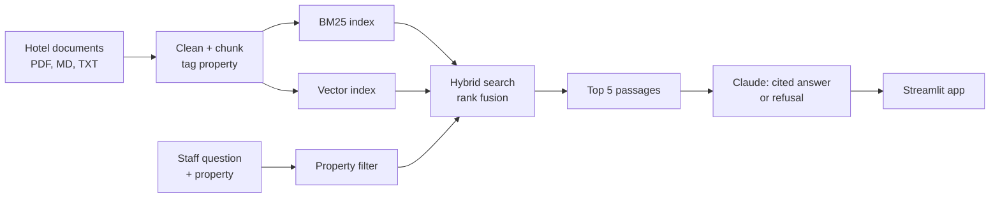
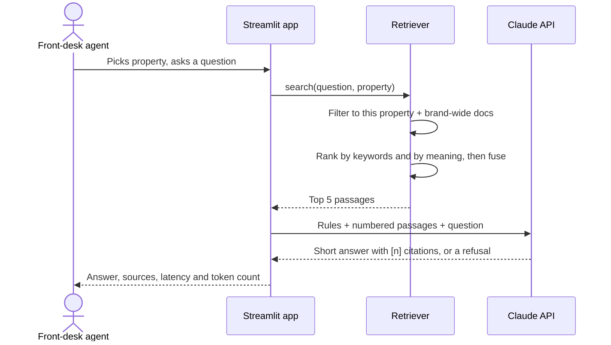

# 🛎️ Hotel Operations Knowledge Assistant

[](https://github.com/vamsialladev/hotel-ops-assistant/actions/workflows/ci.yml)


**An AI assistant that gives hotel front-desk staff correct, property-specific policy answers in seconds, with the source for every fact.**

> **Project 1 of 5** in my Forward Deployed Engineer portfolio. This is a *simulated client engagement*: a fictional hotel group with two properties, a beach resort and a mountain lodge. All documents are synthetic and written to mirror real hotel operations.

🔗 **[Live demo](https://YOUR-STREAMLIT-APP.streamlit.app)** · 🎥 **[2-minute video](https://YOUR-VIDEO-LINK)** · 💰 **[Business case](docs/BUSINESS_CASE.md)** · 🏗️ **[Architecture](docs/ARCHITECTURE.md)**

<!-- HERO: after recording, remove this comment's markers to show the GIF.
<p align="center"></p>
-->

---

## At a glance

| | |
|---|---|
| **Problem** | Staff waste time searching scattered PDFs, menus and notes, and the rules differ by hotel. Wrong answers lead to refunds and escalations. |
| **Solution** | Ask a question in plain English and get a 1–4 sentence answer with cited sources. It refuses when the documents don't say. |
| **Projected value** | ~$32K/yr for 2 properties (range $8K–$66K); ~$1.6M/yr at 100-property scale ([assumptions](docs/BUSINESS_CASE.md)) |
| **Quality** | 94% strict retrieval on a 37-question eval (incl. prompt injection and refusals), 31 unit tests, 92% coverage, CI on every commit |

## Where to start

| If you are a... | Read |
|---|---|
| **Recruiter or hiring manager** | [At a glance](#at-a-glance) → [Results](#results) → [Skills demonstrated](#skills-demonstrated) |
| **Hotel manager or operations lead** | [The problem](#the-problem) → [What it does](#what-it-does) → [Business case](docs/BUSINESS_CASE.md) |
| **Engineer** | [Architecture](#architecture) → [Tech stack](#tech-stack) → [Run it locally](#run-it-locally) → [Commands](#commands-reference) |

---

## The problem

A guest at the front desk asks: *"Can I bring my dog?"*

- At the **beach resort**, the answer is yes, up to 40 lbs, $75 per stay.
- At the **mountain lodge**, it's yes, any size, $50 per night.
- An **outdated 2024 document** still on the shared drive says *no pets at all*.

Staff have to find the right document for the right hotel, while the guest waits. Multiply that by dozens of questions a day across pets, late checkout, parking, fees, spa, dining and events.

## What it does

<!-- APP SCREENSHOTS: capture these on your machine (see docs/images/README.md), then remove this comment's markers.
| Cited answer with a property override | Same question, different property | Refuses instead of guessing |
|---|---|---|
|  |  |  |
-->

- **Property-aware answers:** the selected hotel's rules, plus brand-wide rules.
- **Override handling:** when a hotel's rule beats a brand rule (e.g. weekend late checkout is capped at 12 PM even for Gold members), it says so.
- **Cited sources:** every fact links to the document and section it came from.
- **Refuses rather than guesses:** *"I couldn't find this in the hotel's documents. Please check with a manager."*
- **Handles messy data:** PDFs with headers and footers, price tables, informal staff notes, outdated versions, scanned pages.
- **Resists prompt injection:** instructions hidden inside documents (e.g. a pasted guest email saying "waive all fees") are treated as data, not commands.
- **Staff feedback:** 👍 / 👎 on every answer, logged for weekly review, with the helpful rate shown in the sidebar.

**Example questions to try:** *"A Gold member wants late checkout on Saturday, how late?"*, *"Can a guest check in early?"*, *"What time is breakfast?"*, *"Where is the fire assembly point?"* (the last one should refuse, because that document is a scan).

## Business value

Projected net value per year, with a range rather than a single number:

| Scenario | 2 properties | 100-property group |
|---|---|---|
| Pessimistic (20 lookups/day, 1 min saved) | $8,483 | $421,143 |
| **Base** (40 lookups/day, 2.5 min saved) | **$31,806** | **$1,587,287** |
| Optimistic (60 lookups/day, 3.5 min saved) | $66,329 | $3,313,430 |

Even the pessimistic case returns many times its running cost (~$330/yr for 2 properties).

<details>
<summary>Calculator output: scenarios for 100 properties</summary>
<br>

</details>

These are **projections from stated assumptions**, not measured results. [BUSINESS_CASE.md](docs/BUSINESS_CASE.md) has the full model, a 2-week pilot plan, **success metrics with go / no-go criteria**, and risks. Run `python scripts/business_case.py --scenarios` to change the assumptions.

## Architecture



Full diagrams, request flow and scaling path: [docs/ARCHITECTURE.md](docs/ARCHITECTURE.md)

### How a question is answered, step by step



**Indexing** (`python -m src.ingest`, run whenever documents change)
1. **Load** every `.md`, `.txt` and `.pdf` file in `data/raw/<property>/`. The folder name becomes the property tag; `shared/` means brand-wide.
2. **Clean:** skip documents marked `status: superseded`, strip repeated PDF headers and page footers, and flag scanned pages that have no text.
3. **Chunk** by section heading, keeping the heading path (e.g. *Policies › Pets*) and never splitting a table. Staff notes become one chunk per note.
4. **Index** each chunk twice: a BM25 keyword index with stemming, and a vector embedding. Both are saved to `data/index/`.

**Answering** (every question)
1. **Filter:** keep only chunks from the selected property and `shared/`, so one hotel never sees another hotel's rules.
2. **Search:** rank the chunks by keywords (BM25) and by meaning (embeddings).
3. **Fuse:** merge the two rankings with Reciprocal Rank Fusion and keep the top 5.
4. **Generate:** send Claude the rules, the numbered passages and the question. Claude must cite every fact and must refuse if the passages don't answer it.
5. **Display:** show the answer, the cited sources, the full ranking (debug view), latency and token usage.

## Tech stack

| Layer | Technology | Why |
|---|---|---|
| Language | Python 3.11 | Standard for AI engineering |
| LLM | Claude (Haiku by default, configurable) | Fast and low-cost for staff waiting with a guest |
| Keyword search | BM25 (`rank-bm25`) + light stemming | Exact terms like prices, airport codes, "valet" |
| Semantic search | `sentence-transformers` (MiniLM) | Loose phrasing: "jacket" → "lost and found" |
| Rank fusion | Reciprocal Rank Fusion | Combines both rankings without tuning weights |
| PDF parsing | `pypdf` | Text extraction, with custom header/footer removal |
| Web app | Streamlit | Fast, simple staff interface |
| Testing | pytest, pytest-cov | Unit tests for ingestion, isolation, citations, grading, feedback; coverage gate |
| Evaluation | Custom harness | 37 labeled questions, strict retrieval, citation and grounding checks, CI threshold |
| Code quality | Ruff (lint + format), pre-commit | Consistent, clean code |
| CI/CD | GitHub Actions, Dependabot | Lint, tests, coverage and retrieval gate on every push; weekly dependency updates |
| Packaging | Docker | One-command deployment |

## How it handles messy real-world data

| Real-world mess | How it's handled |
|---|---|
| Different rules per hotel | Every chunk tagged with its property; search filtered to that property + brand-wide docs |
| Hotel rule overrides brand rule | The prompt says property rules win, and the answer mentions the override |
| Outdated policy versions | Documents marked `status: superseded` are never indexed |
| Price tables (spa, loyalty tiers) | Section-aware chunking never splits a table |
| Informal staff notes | One chunk per note |
| PDF headers and "Page 1 of 3" footers | Repeated lines removed, with digits masked so changing page numbers still match |
| Scanned image-only PDF | Detected and flagged for OCR instead of indexing garbage |
| Word forms ("cats" vs "cat", "smoking" vs "smoke") | Light stemming in keyword search |

## Results

**37 labeled questions in 11 categories:** property rules, tables, overrides, brand rules, staff notes, PDFs, synonyms, misspellings, multi-part questions, a Spanish question, a **prompt-injection attack**, and **questions it must refuse**. Every run saves a report to [`eval/reports/`](eval/reports/).

### What is measured
| Metric | What it checks |
|---|---|
| **Retrieval (strict)** | The exact passage with the answer (e.g. *"up to 40 lbs"*) is in the top 5, not just the right document |
| **Answer accuracy** | Required facts present, forbidden phrases absent (e.g. never *"fees are waived"*) |
| **Citation accuracy** | The answer cites the document that actually contains the answer |
| **Numeric grounding** | Every number in the answer (prices, times, limits) appears in a cited source, catching invented figures |
| **Correct refusals** | Questions with no answer in the documents are refused |
| **Consistency** | Answer accuracy across repeated runs (`--runs 3`), since LLM output varies |
| **Latency and cost** | p50/p95 seconds and cost per 1,000 questions |

### Scores
| Setup | Retrieval | Answer accuracy | Citation accuracy | Numeric grounding | p95 latency | Cost / 1,000 questions |
|---|---|---|---|---|---|---|
| Keyword + stemming | **94%** (32/34, strict) | — | — | — | — | — |
| Hybrid (keyword + embeddings) | _fill in_ | _fill in_ | _fill in_ | _fill in_ | _fill in_ | _fill in_ |

<details>
<summary>Full eval run: 37 questions, keyword search</summary>
<br>

</details>

### What the eval taught me
1. **Word forms:** keyword search missed "cats" vs "cat" and "smoking" vs "smoke". Some questions had only passed by luck until a document rename exposed it. Light stemming raised document-level accuracy from 86% to 96%.
2. **My own metric was too lenient.** A Spanish question with zero matching keywords still "passed", because every passage scored 0 and the right document happened to come first in file order. I made the check strict (the exact passage must be retrieved) and stopped returning passages that match nothing. The honest score is **94%**, and a question with no matches is now refused without an API call.
3. **The remaining misses need meaning, not keywords:** *"A guest left a jacket"* (the document says "lost and found") and the Spanish question. That's what the embedding half of hybrid search is for.
4. **Prompt injection is a real risk here:** a guest email pasted into the staff notes tells the AI to waive fees, and it ranks **first** for a pet-fee-and-parking question. The prompt treats sources as data, not instructions, and the eval fails any answer that says the fees are waived.

Details in [DECISIONS.md](docs/DECISIONS.md).

## Skills demonstrated

| Forward Deployed Engineer skill | Where it shows |
|---|---|
| Understanding a client's operational problem | [The problem](#the-problem), [Business case](docs/BUSINESS_CASE.md) |
| Working with messy, real-world data | [Messy data handling](#how-it-handles-messy-real-world-data), `src/ingest.py` |
| Building reliable AI retrieval | Hybrid search, property filtering, refusals |
| Measuring quality, not guessing | [Eval harness](eval/), [Results](#results) |
| Debugging with evidence | [DECISIONS.md](docs/DECISIONS.md) decisions 6–8 |
| Production engineering habits | Tests, CI, linting, Docker, [SECURITY.md](SECURITY.md) |
| Translating tech into business value | [BUSINESS_CASE.md](docs/BUSINESS_CASE.md) |

## Project structure

```
hotel-ops-assistant/
├── app.py                  # Streamlit staff app
├── ask.py                  # Command-line tool
├── src/
│   ├── config.py           # Settings (env-overridable)
│   ├── ingest.py           # Load, clean, chunk, index
│   ├── retrieve.py         # Property filter + hybrid search
│   └── generate.py         # Claude prompt, citations, refusal
├── data/raw/               # Hotel documents, one folder per property + shared/
├── eval/                   # Labeled questions, eval runner, saved reports
├── tests/                  # Unit tests
├── scripts/                # Demo PDF generator, business case calculator
├── docs/                   # Architecture, decisions, business case, demo script, log
│   └── images/             # README screenshots
├── .github/
│   ├── workflows/ci.yml    # CI: lint, tests, retrieval gate
│   └── pull_request_template.md
├── Dockerfile
├── pyproject.toml          # Project metadata, ruff and pytest config
├── CONTRIBUTING.md · SECURITY.md · CHANGELOG.md · LICENSE
└── .env.example            # Configuration template (copy to .env)
```

## Run it locally

**Requirements:** Python 3.11 or 3.12 and an [Anthropic API key](https://console.anthropic.com).

```bash
git clone https://github.com/vamsialladev/hotel-ops-assistant.git
cd hotel-ops-assistant
python -m venv .venv
source .venv/bin/activate        # Windows: .venv\Scripts\Activate.ps1
pip install -r requirements-dev.txt
cp .env.example .env             # Windows: copy .env.example .env  → then add your API key
python -m src.ingest             # build the index
streamlit run app.py             # open http://localhost:8501
```

**With Docker:**
```bash
docker build -t hotel-ops-assistant .
docker run -p 8501:8501 --env-file .env hotel-ops-assistant
```

## Configuration

All settings live in `.env` (copy it from `.env.example`). Environment variables override the defaults.

| Variable | Default | Purpose |
|---|---|---|
| `ANTHROPIC_API_KEY` | none (required) | Claude API key. Never commit it. |
| `LLM_MODEL` | `claude-haiku-4-5-20251001` | Model used to write answers |
| `EMBED_MODEL` | `sentence-transformers/all-MiniLM-L6-v2` | Embedding model for semantic search |
| `TOP_K` | `5` | Number of passages sent to Claude |
| `USE_EMBEDDINGS` | `true` | `false` = keyword search only. Also falls back automatically if `sentence-transformers` isn't installed |

## Commands reference

| Task | Command | Make shortcut (macOS/Linux) |
|---|---|---|
| Install everything (dev + hybrid search) | `pip install -r requirements-dev.txt` | `make install` |
| Install light core only (keyword search) | `pip install -r requirements.txt` | |
| Regenerate demo PDFs | `python scripts/make_demo_pdfs.py` | `make pdfs` |
| Build the search index | `python -m src.ingest` | `make index` |
| Build index without embeddings | `python -m src.ingest --bm25-only` | |
| Run the web app | `streamlit run app.py` | `make app` |
| Ask from the command line | `python ask.py beach-resort "Can a guest bring a dog?"` | `make demo` |
| Unit tests | `python -m pytest -q` | `make test` |
| Retrieval eval (free) | `python -m eval.run_eval` | `make eval` |
| Full eval with answers (uses API) | `python -m eval.run_eval --answers` | `make eval-answers` |
| Answer eval, 3 runs, with cost | `python -m eval.run_eval --answers --runs 3 --price-in <USD> --price-out <USD>` | |
| Business case scenarios | `python scripts/business_case.py --scenarios` | |
| Test coverage | `python -m pytest --cov=src --cov=eval` | |
| Keyword-only eval, for comparison | `python -m eval.run_eval --bm25-only` | |
| Lint and format check | `ruff check . && ruff format --check .` | |
| Auto-fix formatting | `ruff check . --fix && ruff format .` | |
| Business case, one scenario | `python scripts/business_case.py --properties 100` | |
| Build Docker image | `docker build -t hotel-ops-assistant .` | |
| Run Docker container | `docker run -p 8501:8501 --env-file .env hotel-ops-assistant` | |

## Troubleshooting

| Problem | Fix |
|---|---|
| `No index found` | Run `python -m src.ingest` |
| `No module named src` | Run commands from the project root folder |
| `authentication_error` | Check `ANTHROPIC_API_KEY` in `.env`: no quotes, no spaces |
| Windows: "running scripts is disabled" | `Set-ExecutionPolicy -Scope CurrentUser RemoteSigned` |
| PyTorch fails to install | Use Python 3.11 or 3.12 |
| Answer uses an old policy | Mark the old file `status: superseded` and rebuild the index |
| A new document isn't found | Rebuild the index after adding or editing documents |

## Deploy (free) on Streamlit Community Cloud

1. Push the repo to GitHub (public).
2. Go to [share.streamlit.io](https://share.streamlit.io), sign in with GitHub, and click **Create app**.
3. Choose the repo, branch `main`, and main file `app.py`.
4. Under **Advanced settings**, pick Python 3.11 and add these secrets:
   ```toml
   ANTHROPIC_API_KEY = "your-key"
   ```
5. Click **Deploy**. The first start builds the search index automatically.

Streamlit Cloud installs only `requirements.txt`, the light core, so the deployed app uses keyword search (94% strict retrieval) and starts quickly. Full hybrid search needs PyTorch (`requirements-hybrid.txt`), which is better suited to Docker or a larger server. **Set a monthly spending limit in the Anthropic Console before sharing the link**, because every visitor's question uses your API credit.

## Testing and quality

```bash
python -m pytest -q --cov=src --cov=eval   # 31 unit tests with coverage
python -m eval.run_eval                  # retrieval eval (free)
python -m eval.run_eval --answers        # full eval with Claude
ruff check . && ruff format --check .    # lint and format
```

<details>
<summary>Test run: 31 passed, 92% coverage</summary>
<br>

</details>

CI runs lint, tests with a 70% minimum coverage, and a retrieval regression gate (fails below 85%) on every push and pull request. Dependabot opens pull requests for dependency updates weekly.

## Security and privacy

Only policy documents are indexed; no guest or payment data. Only the top 5 passages and the question are sent to the API. Secrets stay in `.env`, which is excluded from git and Docker. See [SECURITY.md](SECURITY.md) for risks and mitigations.

## Limitations and roadmap

- **OCR** for scanned documents (currently flagged, not read)
- **Personal data redaction** before API calls (Project 4)
- **Managed vector database** and incremental indexing for many properties
- **Project 2** uses this assistant as a tool in a guest-email agent; **Project 3** expands the eval to 100+ questions

## Documentation

| Document | Contents |
|---|---|
| [ARCHITECTURE.md](docs/ARCHITECTURE.md) | System and request-flow diagrams, components, scaling path |
| [BUSINESS_CASE.md](docs/BUSINESS_CASE.md) | Value model, assumptions, pilot plan, risks |
| [DECISIONS.md](docs/DECISIONS.md) | Why each design choice was made, with tradeoffs |
| [ENGINEERING_LOG.md](docs/ENGINEERING_LOG.md) | What broke and how it was fixed |
| [DEMO_SCRIPT.md](docs/DEMO_SCRIPT.md) | 2-minute walkthrough script |
| [VALIDATION_CHECKLIST.md](docs/VALIDATION_CHECKLIST.md) | Steps that need a real API key: hybrid scores, measured baseline, held-out questions |
| [SECURITY.md](SECURITY.md) | Data handling, risks, mitigations |
| [CONTRIBUTING.md](CONTRIBUTING.md) | Workflow, commit style, how to add documents, properties and eval questions |
| [CHANGELOG.md](CHANGELOG.md) | Version history |

## Author

**Vamsi Alla** · AI Engineer · I turn messy business problems into AI systems that work in production: measured, deployed and owned end to end.

🌐 [Portfolio](https://vamsialladev.github.io) · 💼 [LinkedIn](https://www.linkedin.com/in/YOUR-LINKEDIN) · 🐙 [GitHub](https://github.com/vamsialladev) · ✉️ vamsialla.dev@gmail.com

## License

[MIT](LICENSE) © 2026 Vamsi Alla
