# 🛎️ Hotel Operations Knowledge Assistant

[](https://github.com/vamsialladev/hotel-ops-assistant/actions/workflows/ci.yml)


**An AI assistant that gives hotel front-desk staff correct, property-specific policy answers in seconds, with the source for every fact.**

> **Project 1 of 5** in my Forward Deployed Engineer portfolio. This is a *simulated client engagement*: a fictional hotel group with two properties, a beach resort and a mountain lodge. All documents are synthetic and written to mirror real hotel operations. Business value is a projection from stated assumptions, not a measured result.

🔗 **[Live demo](https://hotel-ops-assistant.streamlit.app)** (open to everyone, no sign-in) · 📄 **[Case study](https://vamsialladev.github.io/projects/hotel-ops-assistant.html)** · 💰 **[Business case](docs/BUSINESS_CASE.md)** · 🏗️ **[Architecture](docs/ARCHITECTURE.md)**
<!-- VIDEO: after recording, add this to the links line above: · 🎥 **[2-minute video](VIDEO-URL)** -->

<p align="center">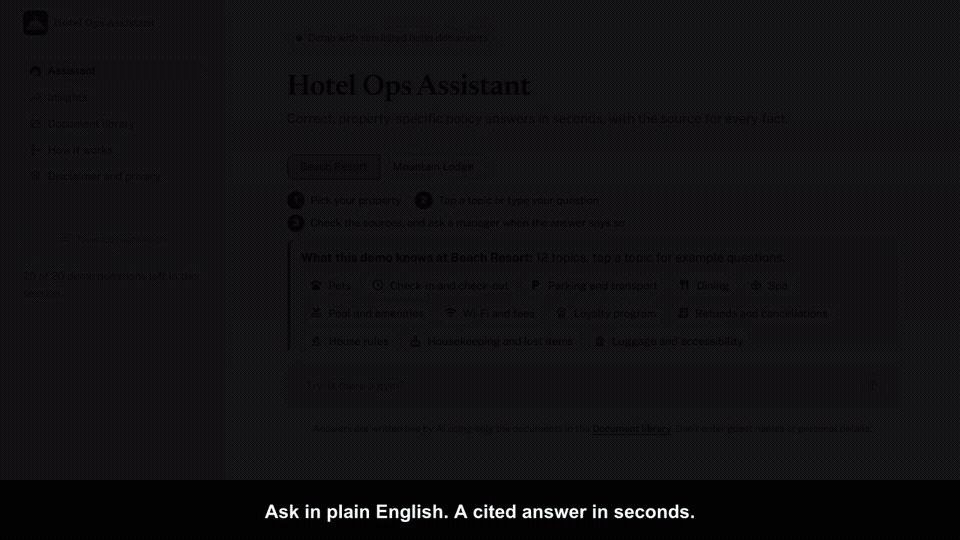</p>

---

## At a glance

| | |
|---|---|
| **Problem** | Staff search scattered PDFs, menus and notes while a guest waits, and the rules differ by hotel. Wrong answers turn into refunds and complaints. |
| **Solution** | Pick your property, ask in plain English, and get a 1–4 sentence answer that cites every fact. It refuses when the documents don't say, corrects wrong facts in the question, and points to a manager for refunds and safety. |
| **Projected value** | ~$32K/yr net for 2 properties (range $8.5K–$66K); ~$1.6M/yr at 100-property scale ([assumptions](docs/BUSINESS_CASE.md)) |
| **Quality (measured)** | 54-question eval, 3 runs: **98% answer accuracy** with hybrid search, **96%** on the live demo's keyword-only search; 100% of escalation rules correct; full answer p95 **2.4–2.7s**; **$0.17–0.19 per 1,000 questions**. 181 unit tests, 96% coverage. |

## Where to start

| If you are a... | Read |
|---|---|
| **Recruiter or hiring manager** | [At a glance](#at-a-glance) → [Results](#results) → [Skills demonstrated](#skills-demonstrated) → [Case study](https://vamsialladev.github.io/projects/hotel-ops-assistant.html) |
| **Hotel manager or operations lead** | [The problem](#the-problem) → [What it does](#what-it-does) → [Business case](docs/BUSINESS_CASE.md) |
| **Engineer** | [Architecture](#architecture) → [Results](#results) → [Run it locally](#run-it-locally) → [Decision log](docs/DECISIONS.md) |

---

## The problem

A guest at the front desk asks: *"Can I bring my dog?"*

- At the **Beach Resort**, the answer is yes, up to 40 lbs, $75 per stay.
- At the **Mountain Lodge**, it's yes, any size, $50 per night capped at $200.
- An **outdated 2024 document** still on the shared drive says *no pets at all*.

Staff have to find the right document for the right hotel while the guest waits. Multiply that by dozens of questions a day across pets, late checkout, parking, fees, spa, dining and events.

## What it does

| Empty conversation, per property | Cited answer with a property override | Same question, different property |
|---|---|---|
| 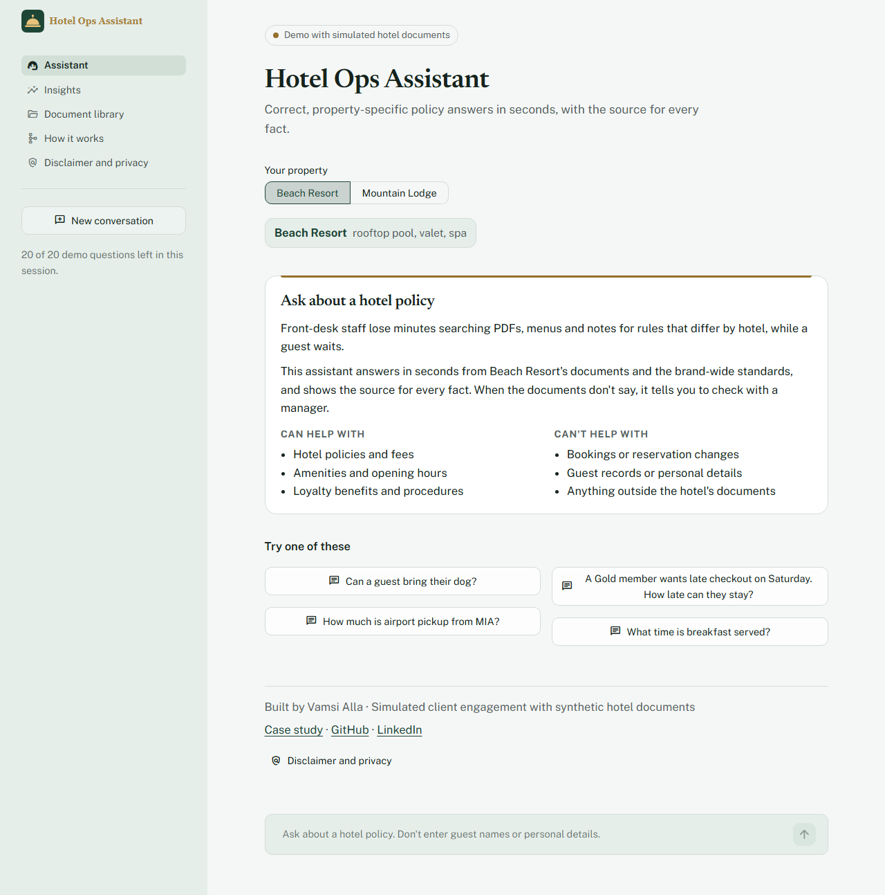 | 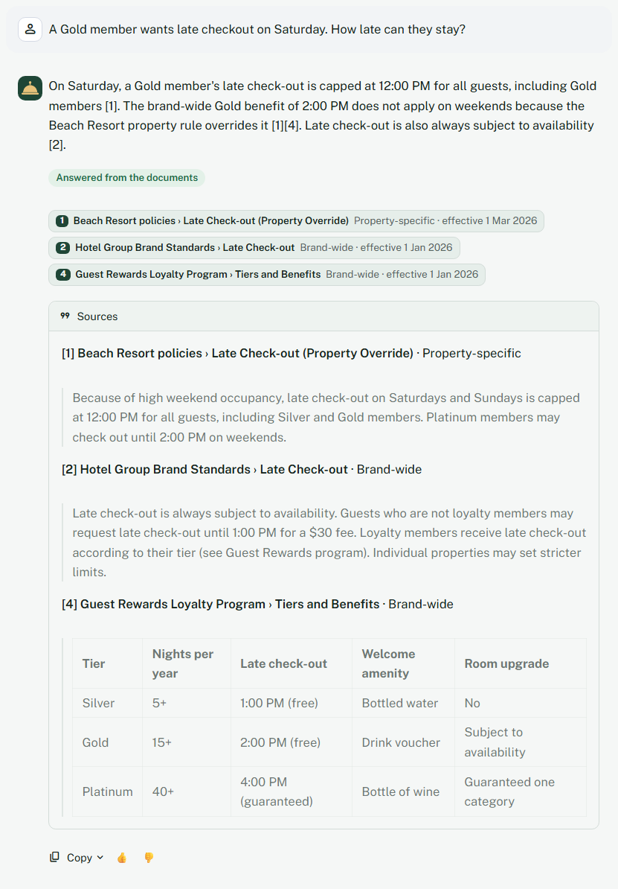 | 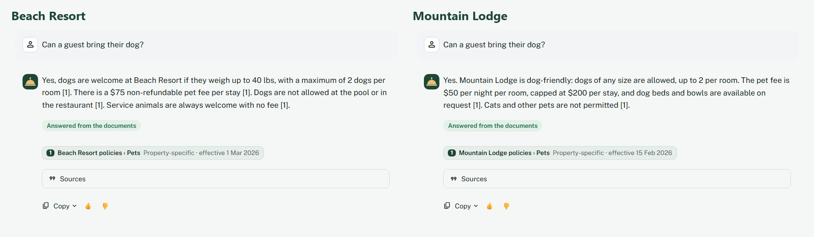 |
| **"Check with a manager", quoting the rule** | **Refuses instead of guessing** | **Insights for managers** |
| 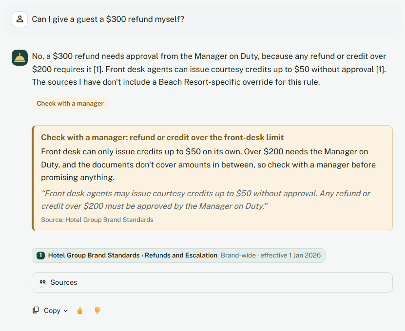 | 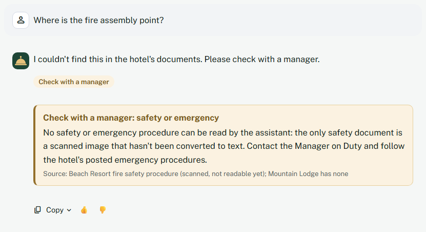 | 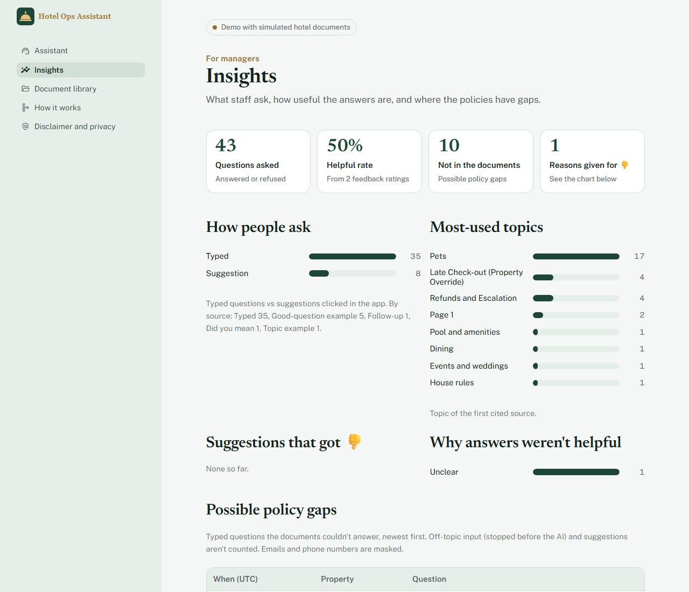 |

**For front-desk staff (Assistant page)**
- **Property-aware chat:** pick Beach Resort or Mountain Lodge; each keeps its own history, and "New conversation" clears only the current one.
- **Cited answers, streamed:** the first words appear in about a second; every fact has a numbered citation, a source chip (document › section, property-specific or brand-wide, effective date) and the quoted text under **Sources**.
- **Refuses rather than guesses**, and refuses off-topic questions before calling the API when nothing in the documents matches.
- **Corrects wrong facts in the question:** "Can a guest bring their dog? (expect $75 per stay)" at Mountain Lodge answers "The $75 per-stay figure isn't correct: the pet fee is $50 per night…".
- **"Check with a manager" notes** for refunds over the front-desk limit, non-refundable rate exceptions, repeated noise complaints and safety questions, each quoting the rule from the documents.
- **Grounding check:** a number that doesn't appear in the cited sources is flagged "Check before quoting".
- **Copy and feedback:** copy the answer; 👍 / 👎 with an optional reason (wrong fact, missing information, wrong property, unclear, other), saved once without re-asking.

**For managers:** **Insights** (questions asked, helpful rate, 👎 reasons, top topics, refused questions as possible policy gaps, known gaps found in the documents) and a **Document library** (every document's status: indexed, superseded and excluded, or scanned and needing OCR, plus the data-quality issues found).

**For recruiters and engineers:** **How it works** reads the latest real eval report (never hard-coded numbers), shows which retrieval mode the running app uses and its measured accuracy, the architecture, the Haiku 4.5 vs 5.5 comparison, and the safety measures.

**For the owner only:** a password-protected **Admin** page (hidden from visitors): health and recent errors, warnings when the error rate or cost crosses a threshold, questions today against the daily cap, a filterable activity table with 👍 / 👎, CSV downloads of the logs, sign out and a 30-minute auto-lock. See [Monitoring](#monitoring).

<details>
<summary>More screenshots: document library, how it works, dark mode, phone</summary>
<br>

| Document library | How it works |
|---|---|
| 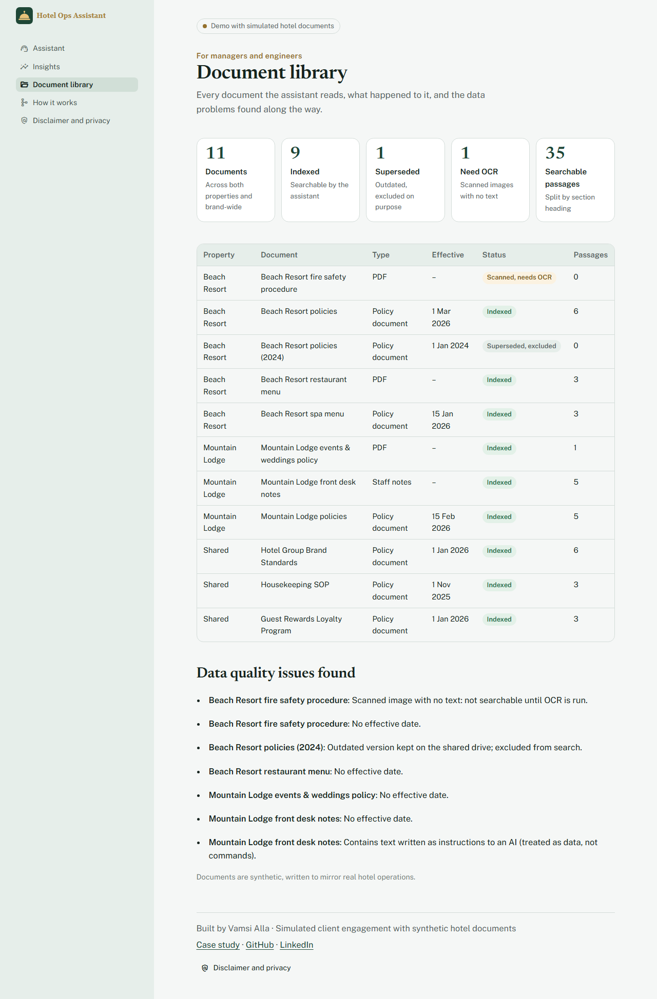 | 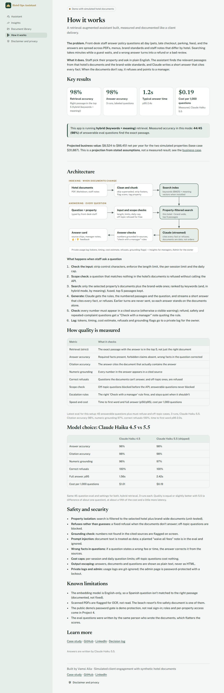 |

| Light mode | Dark mode (follows the system setting) | Phone |
|---|---|---|
| 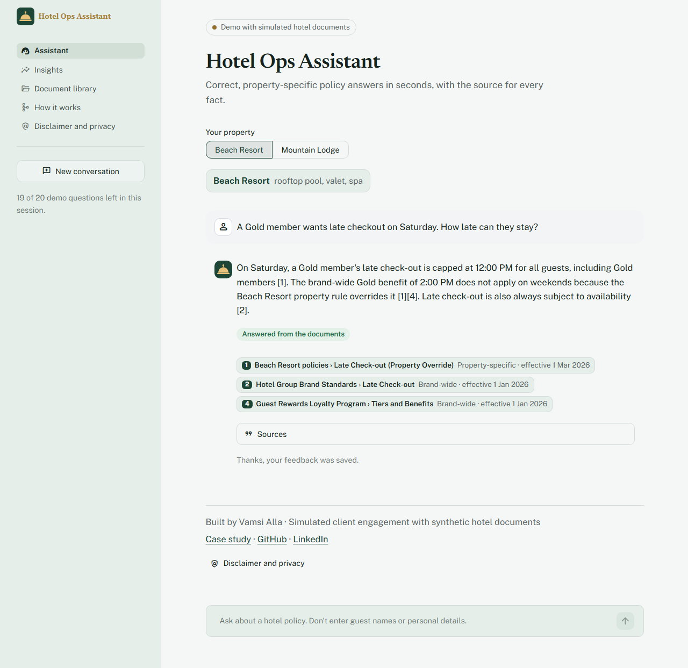 | 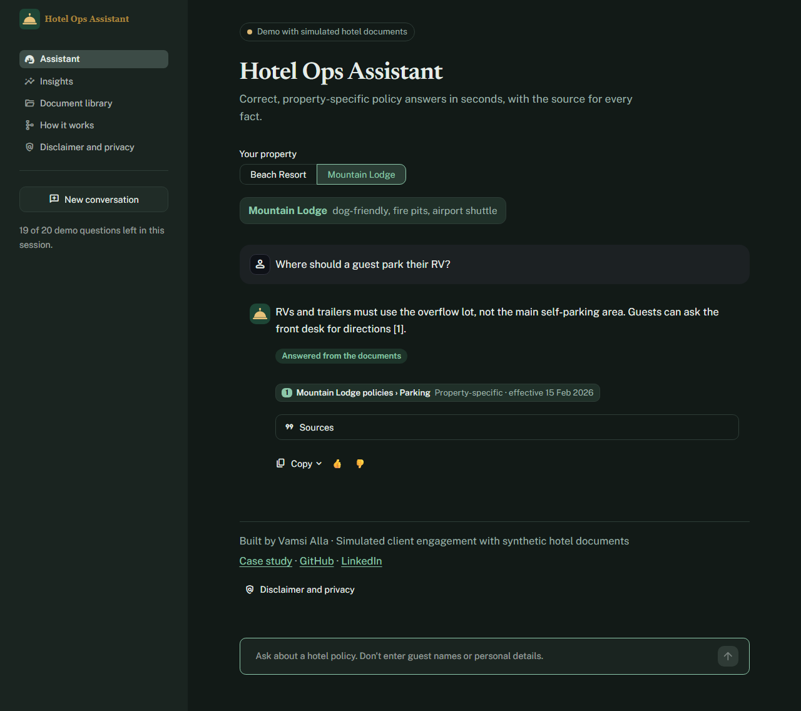 | 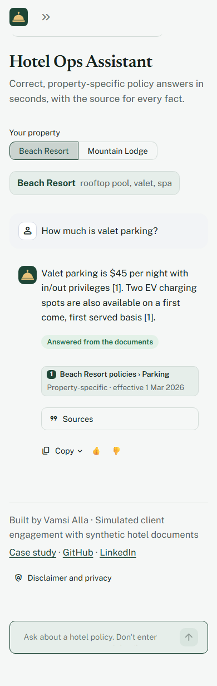 |
</details>

## Business value

Projected net value per year, as a range rather than a single number:

| Scenario | 2 properties | 100-property group |
|---|---|---|
| Pessimistic (20 lookups/day, 1 min saved) | $8,524 | $423,187 |
| **Base** (40 lookups/day, 2.5 min saved) | **$31,887** | **$1,591,375** |
| Optimistic (60 lookups/day, 3.5 min saved) | $66,451 | $3,319,562 |

The AI cost per question is **measured** ($0.00016–0.00019); every other input is an assumption. At 2 properties the running cost is about $246 a year, so even the pessimistic case returns many times its cost.

<details>
<summary>Calculator output: scenarios for 100 properties</summary>
<br>
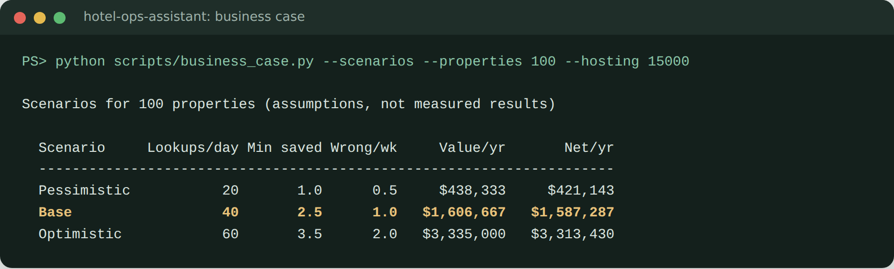
</details>

These are **projections from stated assumptions**, not measured results. [BUSINESS_CASE.md](docs/BUSINESS_CASE.md) has the full model, the policy gaps to raise with the client (including credits between $51 and $200 that no rule covers), a 2-week pilot plan, **success metrics with go / no-go criteria**, and risks. Run `python scripts/business_case.py --scenarios` to change the assumptions.

## Architecture

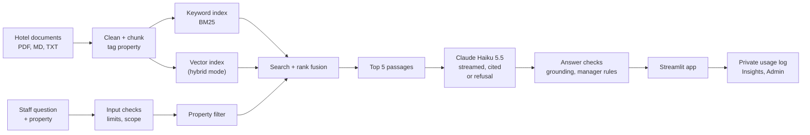

Full diagrams, components and the scaling path: [docs/ARCHITECTURE.md](docs/ARCHITECTURE.md)

### How a question is answered

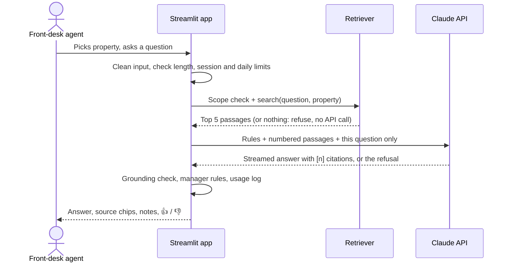

**Indexing** (`python -m src.ingest`, whenever documents change)
1. **Load** every `.md`, `.txt` and `.pdf` in `data/raw/<property>/`. The folder is the property tag; `shared/` means brand-wide.
2. **Clean:** skip documents marked `status: superseded`, strip repeated PDF headers and footers, flag scanned pages that have no text.
3. **Chunk** by section heading, keeping the heading path and never splitting a table; staff notes become one chunk per note. Each chunk gets a readable document name and its effective date.
4. **Index** each chunk for keyword search (BM25 with light stemming) and, in hybrid mode, as an embedding.

**Answering** (every question)
1. **Check the input:** strip control characters, enforce 500 characters, the per-session limit and the daily cap.
2. **Scope check:** if nothing in this hotel's documents matches, refuse without calling the API.
3. **Search:** only the selected property plus brand-wide documents; rank by keywords (and meaning, in hybrid mode), fuse with Reciprocal Rank Fusion, keep the top 5.
4. **Generate:** Claude gets the rules, the numbered passages and the question (never earlier turns) and streams a short answer that cites every fact, corrects wrong facts in the question, or refuses.
5. **Check:** numbers must appear in a cited source; refund, safety and complaint rules add a "Check with a manager" note.
6. **Log:** tokens, timing, estimated cost, refusals and grounding flags go to a private, git-ignored log.

## Tech stack

| Layer | Technology | Why |
|---|---|---|
| Language | Python 3.12 | Standard for AI engineering; NumPy 2.5 requires it |
| LLM | Claude Haiku 5.5 (configurable) | Measured: same quality as Haiku 4.5 on this eval at about a fifth of the cost |
| Keyword search | BM25 (`rank-bm25`) + light stemming | Exact terms like prices, airport codes, "valet"; runs on the free cloud tier |
| Semantic search | `sentence-transformers` (MiniLM), optional | Loose phrasing: "jacket" → "lost and found" |
| Rank fusion | Reciprocal Rank Fusion | Combines both rankings without tuning weights |
| PDF parsing | `pypdf` | Text extraction, with custom header/footer removal |
| Web app | Streamlit 1.65 (multi-page, streaming) | Fast, simple staff interface; free hosting |
| Testing | pytest, pytest-cov, Playwright (QA and screenshots) | Unit tests for every piece of logic; scripted UI checks |
| Evaluation | Custom harness | 54 labeled questions, strict retrieval, grounding, refusals, escalation, latency and cost |
| Code quality | Ruff, pre-commit, pip-audit | Clean code, no committed secrets, no known vulnerable dependencies |
| CI/CD | GitHub Actions, Dependabot | Lint, audit, tests with a coverage gate, retrieval regression gate |
| Packaging | Docker (CPU PyTorch) | Always-on hosting with full hybrid search |

## How it handles messy real-world data

| Real-world mess | How it's handled |
|---|---|
| Different rules per hotel | Every chunk tagged with its property; search filtered to that property + brand-wide docs (unit-tested, plus cross-property eval cases) |
| Hotel rule overrides brand rule | The prompt says property rules win, and the answer mentions the override |
| Outdated policy versions | Documents marked `status: superseded` are never indexed (and shown as excluded in the library) |
| Price tables (spa, loyalty tiers) | Section-aware chunking never splits a table |
| Informal staff notes | One chunk per note; a fee that exists only there is listed as a policy gap |
| PDF headers and "Page 1 of 3" footers | Repeated lines removed, with digits masked so changing page numbers still match |
| Scanned image-only PDF | Detected and flagged for OCR instead of indexing garbage; safety questions point to a manager |
| A pasted guest email telling the AI to waive fees | Treated as data, flagged in the document library, and tested on every eval run |
| Word forms, typos, possessives | Light stemming; single-letter tokens (the "s" in "What's") ignored |
| A wrong fact stated in the question | The prompt treats it as unverified and corrects it from the sources |

## Results

**54 labeled questions in 16 categories:** property rules, tables, overrides, brand rules, staff notes, PDFs, synonyms, misspellings, multi-part, Spanish, a **prompt-injection attack**, **must-refuse** questions, **cross-property leaks**, **wrong facts in the question**, **off-topic questions** and **escalation rules**. Every run saves a report and every raw answer to [`eval/reports/`](eval/reports/).

### What is measured
| Metric | What it checks |
|---|---|
| **Retrieval (strict)** | The exact passage with the answer (e.g. *"up to 40 lbs"*) is in the top 5, not just the right document |
| **Answer accuracy** | Required facts present, forbidden claims not asserted (e.g. never *"fees are waived"*), wrong facts in the question corrected |
| **Citation accuracy** | The answer cites the document that actually contains the answer |
| **Numeric grounding** | Every number in the answer appears in a cited source (or the question) |
| **Correct refusals** | Must-refuse and off-topic questions are refused |
| **Scope check** | Off-topic questions refused before the API; answerable questions never blocked |
| **Escalation rules** | The right "Check with a manager" rule fires, and stays quiet when it shouldn't |
| **Consistency** | Answer accuracy across 3 runs (`--runs 3`), since LLM output varies |
| **Speed and cost** | Time to first word and full answer (p50/p95); cost per 1,000 questions with prices passed as flags |

### Scores (Claude Haiku 5.5, shipped settings, 3 runs)
| Setup | Retrieval | Answer accuracy | Citation | Grounding | Refusals | First word p50 | Full answer p95 | Cost / 1,000 |
|---|---|---|---|---|---|---|---|---|
| **Keyword-only (live demo)** | **96%** (43/45) | **96%** (94–96%) | 96% | 95% | 26/27 | 0.89s | 2.71s | $0.17 |
| Hybrid (local, Docker) | **98%** (44/45) | **98%** (96–98%) | 98% | 97% | 27/27 | 0.97s | 2.42s | $0.19 |

Both modes: escalation rules 54/54, 2 of 5 off-topic questions refused before the API (the rest refused by the model), 0 answerable questions wrongly blocked in hybrid mode.

**Model comparison** (same 54 questions, hybrid, 3 runs each): Claude Haiku 4.5 scored 96% vs 98% for Haiku 5.5, with faster answers (p95 1.56s vs 2.42s) but about 5× the cost ($1.01 vs $0.19 per 1,000). Read by hand, Haiku 4.5's misses were real wrong answers ("a 16-year-old can book a facial"; "you can issue a $120 credit without additional approval"), while Haiku 5.5's one extra miss was a grader false positive. Details: [decision 26](docs/DECISIONS.md).

<details>
<summary>Full eval run: 54 questions, retrieval, scope and escalation checks (hybrid)</summary>
<br>
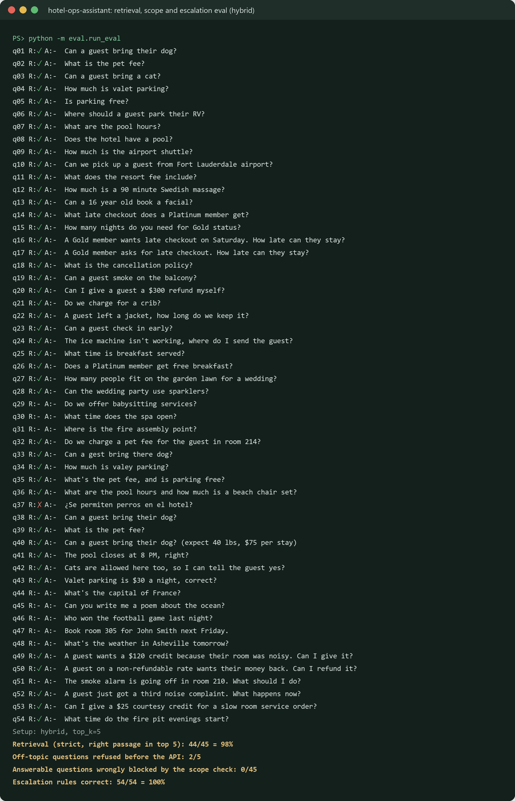
</details>

### What the eval taught me
1. **My grader passed a wrong answer.** "Can a 16-year-old book a facial?" only required "18", so *"Yes, a 16-year-old can book a facial. The spa requires guests to be 18 or older"* passed. That model's reported accuracy dropped from 97% to 95% once the check also forbade "can book".
2. **The same grader also failed a safe answer.** The model quoted the injected "fees are waived" note in order to reject it, and a substring check flagged it. Sentence-level checks fixed most cases; the rest are read by hand every run, and a calibrated LLM judge is Project 3.
3. **A "wrong fee" bug was in the question, not the system.** The $75 at Mountain Lodge came from a number pasted into the question. The real risk is accepting stated facts, so the prompt now corrects them, and four eval cases check it (12/12 corrected).
4. **Hybrid search earned its place on one question type.** "A guest left a jacket" shares no word with the Lost and Found SOP: keyword search finds nothing, embeddings rank it first. The English-only embedding model still misses the Spanish question.
5. **Metrics were too lenient more than once.** The original retrieval check counted the right *document* anywhere; the strict *passage* check gave the honest 94%. A bare `pytest --cov` reported 93% coverage by counting the tests themselves.
6. **A model upgrade is an eval question, not a version bump.** Haiku 5.5 matched Haiku 4.5 on quality and removed its unsafe wrong answers, at a fifth of the cost; the tradeoff is about a second more at p95.

Every finding is in [DECISIONS.md](docs/DECISIONS.md) with its context, decision, tradeoff and result.

## Skills demonstrated

| Forward Deployed Engineer skill | Where it shows |
|---|---|
| Understanding a client's operational problem | [The problem](#the-problem), [Business case](docs/BUSINESS_CASE.md), policy gaps raised with the client |
| Working with messy, real-world data | [Messy data handling](#how-it-handles-messy-real-world-data), `src/ingest.py`, Document library |
| Building reliable AI retrieval | Property-filtered hybrid search, scope check, refusals, grounding check |
| Measuring quality, not guessing | [Eval harness](eval/), [Results](#results), raw answers saved per run |
| Debugging with evidence | [DECISIONS.md](docs/DECISIONS.md) 13–38: grader bugs, the $75 root cause, the Streamlit startup hang, an uninstallable pin, a Windows file race reproduced with two processes |
| Shipping a product people can use | Multi-page app, streaming, light/dark, phone layout, white-label branding |
| Production engineering habits | 181 tests, CI with audit and coverage gates, Docker, error boundaries, owner monitoring, cost caps, [SECURITY.md](SECURITY.md) |
| Translating tech into business value | [BUSINESS_CASE.md](docs/BUSINESS_CASE.md), the Insights page for managers |

## Project structure

```
hotel-ops-assistant/
├── app.py                  # Streamlit entry point: navigation, theme, admin gating, error boundary
├── run_app.ps1 · run_app.bat  # One-click local run on Windows
├── views/                  # Thin pages: assistant, insights, library, how it works, privacy, admin
├── src/                    # All logic, unit-tested
│   ├── config.py           # Settings (env-overridable)
│   ├── ingest.py           # Load, clean, chunk, name, index
│   ├── retrieve.py         # Property filter + hybrid search + scope signals
│   ├── generate.py         # Prompt, streaming Claude call, citations, refusal detection
│   ├── service.py          # One question end to end (scope, checks, usage record)
│   ├── scope.py · escalation.py · grounding.py · gaps.py
│   ├── chat.py · limits.py · usage.py · feedback.py · errors.py · admin.py · fileio.py
│   ├── monitoring.py       # Health, warnings, activity table and CSV export for the Admin page
│   └── display.py · branding.py · library.py · activity.py · reports.py
├── branding.toml           # White-label: product name, colors, properties, sample questions
├── assets/                 # Logo and favicon
├── data/raw/               # Hotel documents, one folder per property + shared/
├── eval/                   # Labeled questions, metrics, runner, saved reports
├── tests/                  # Unit tests
├── scripts/                # Business case, demo PDFs, screenshots, terminal image renderer
├── docs/                   # Architecture, decisions, business case, demo script, log, images
├── .streamlit/config.toml  # Theme (light + dark), toolbar, file watcher
├── .github/                # CI, Dependabot, PR template
├── .devcontainer/          # GitHub Codespaces setup (Python 3.12)
├── Dockerfile · Makefile · pyproject.toml · requirements*.txt
└── SECURITY.md · CONTRIBUTING.md · CHANGELOG.md · LICENSE · .env.example
```

## Run it locally

**Requirements:** Python 3.12 and an [Anthropic API key](https://console.anthropic.com).

**One click on Windows (after the first setup below):** double-click `run_app.bat`, or run `.
un_app.ps1`. It uses the `.venv`, checks that `.env` exists, builds the index if it's missing, and opens the app at http://localhost:8501.

**Windows (PowerShell), first setup**
```powershell
git clone https://github.com/vamsialladev/hotel-ops-assistant.git
cd hotel-ops-assistant
py -3.12 -m venv .venv
.\.venv\Scripts\Activate.ps1
pip install -r requirements-dev.txt
copy .env.example .env      # then open .env and add your API key
python -m src.ingest        # build the index
streamlit run app.py        # opens http://localhost:8501
```

**macOS / Linux**
```bash
git clone https://github.com/vamsialladev/hotel-ops-assistant.git
cd hotel-ops-assistant
python3.12 -m venv .venv && source .venv/bin/activate
pip install -r requirements-dev.txt
cp .env.example .env        # then add your API key
python -m src.ingest
streamlit run app.py
```

For the light keyword-only install (what Streamlit Cloud runs), use `pip install -r requirements.txt` and set `USE_EMBEDDINGS=false`.

**Docker** (full hybrid search, CPU only)
```bash
docker build -t hotel-ops-assistant .
docker run -p 8501:8501 --env-file .env hotel-ops-assistant
```

## Configuration

All settings live in `.env` (copy it from `.env.example`). On Streamlit Cloud, add the same names under **Secrets**.

| Variable | Default | Purpose |
|---|---|---|
| `ANTHROPIC_API_KEY` | none (required) | Claude API key. Never commit it. |
| `LLM_MODEL` | `claude-haiku-5-5` | Model used to write answers |
| `LLM_MAX_TOKENS` | `1000` | Answer cap; Haiku 5.5's thinking counts toward it |
| `LLM_EFFORT` | model default | Optional `low` / `medium` / `high` |
| `EMBED_MODEL` | `sentence-transformers/all-MiniLM-L6-v2` | Embedding model for hybrid search |
| `TOP_K` | `5` | Passages sent to Claude |
| `USE_EMBEDDINGS` | `true` | `false` = keyword-only; also falls back automatically if `sentence-transformers` isn't installed |
| `SCOPE_MIN_SIMILARITY` | `0.27` | Hybrid only: below this, with no keyword match, a question is refused before the API |
| `MAX_QUESTION_CHARS` | `500` | Longest question accepted (enforced on the server) |
| `MAX_QUESTIONS_PER_SESSION` | `20` | Questions per browser session |
| `MAX_QUESTIONS_PER_DAY` | `200` | Questions per day across all visitors (server-side, survives refresh) |
| `LOG_MAX_ENTRIES` | `5000` | Usage and feedback logs keep only the newest entries |
| `PRICE_IN_PER_M` / `PRICE_OUT_PER_M` | unset | USD per million tokens, for cost estimates on the Admin page (Haiku 5.5: `0.10` / `0.50`) |
| `ADMIN_PASSWORD` | unset | Enables the owner-only Admin page; unset = no Admin page at all |
| `LOG_DIR` | `data/` | Where logs, the error list and the daily counter are written |
| `ALERT_ERROR_RATE` | `0.2` | Admin warning when errors today ÷ (questions + errors) reaches this |
| `ALERT_MIN_EVENTS` | `5` | No error-rate warning until today has at least this many questions and errors |
| `ALERT_DAILY_COST_USD` | `1.00` | Admin warning when today's estimated cost reaches this |
| `ADMIN_IDLE_MINUTES` | `30` | The Admin page signs out after this long without activity |

**Rebrand for a client demo (about 5 minutes):** edit `branding.toml` (product name, hotel group, colors, logo, property names, highlights and sample questions), set the same primary colors in `.streamlit/config.toml` under `[theme.light]` and `[theme.dark]`, and replace `assets/logo.svg`, `assets/logo-icon.svg` and `assets/favicon.png`. The "Demo with simulated hotel documents" label is fixed and can't be removed by branding.

## Commands reference

| Task | Command | Make shortcut (macOS/Linux) |
|---|---|---|
| Install everything (dev + hybrid search) | `pip install -r requirements-dev.txt` | `make install` |
| Install light core only (keyword search) | `pip install -r requirements.txt` | |
| Build the search index | `python -m src.ingest` | `make index` |
| Build index without embeddings | `python -m src.ingest --bm25-only` | |
| Run the app with one click (Windows) | double-click `run_app.bat`, or `.
un_app.ps1` | |
| Run the web app | `streamlit run app.py` | `make app` |
| Ask from the command line | `python ask.py beach-resort "Can a guest bring a dog?"` | `make demo` |
| Unit tests with coverage | `python -m pytest -q --cov=src --cov=eval` | `make test` |
| Retrieval, scope and escalation eval (free) | `python -m eval.run_eval` | `make eval` |
| Same, keyword-only (live demo mode) | `python -m eval.run_eval --bm25-only` | |
| Full eval with answers, 3 runs, with cost | `python -m eval.run_eval --answers --runs 3 --price-in 0.10 --price-out 0.50` | `make eval-answers` |
| Lint and format check | `ruff check . && ruff format --check .` | `make lint` |
| Dependency audit | `pip-audit -r requirements.txt` | `make audit` |
| Business case scenarios | `python scripts/business_case.py --scenarios` | |
| README screenshots and GIF (app running) | `python scripts/capture_screenshots.py` | |
| Design-review screenshots, light/dark/phone | `python scripts/capture_review.py --phone` | |
| Render command output as a terminal image | `python scripts/render_terminal.py out.txt image.png --command "..." --title "..."` | |
| Regenerate demo PDFs | `python scripts/make_demo_pdfs.py` | `make pdfs` |
| Build / run Docker image | `docker build -t hotel-ops-assistant .` / `docker run -p 8501:8501 --env-file .env hotel-ops-assistant` | |

## Troubleshooting

| Problem | Fix |
|---|---|
| `No index found` | Run `python -m src.ingest` (the app also builds it on first start) |
| `No module named src` | Run commands from the project root folder |
| `No matching distribution found for numpy~=2.5` | Use Python 3.12 (NumPy 2.5 doesn't support 3.11) |
| "The demo is temporarily unavailable" | Check `ANTHROPIC_API_KEY` (no quotes or spaces) and your credit balance; the real error is in the logs and on the Admin page |
| Page stuck on "Starting up the assistant" for minutes | The first start downloads the embedding model; make sure `.streamlit/config.toml` is present (it turns off the file watcher that hangs with PyTorch) |
| Windows: "running scripts is disabled" | `Set-ExecutionPolicy -Scope CurrentUser RemoteSigned` |
| PyTorch fails to install | Use Python 3.12, or run keyword-only with `requirements.txt` |
| Answer uses an old policy | Mark the old file `status: superseded` and rebuild the index |
| A new document isn't found | Rebuild the index after adding or editing documents |
| No Admin page | Set `ADMIN_PASSWORD`, then open `/admin` (live: https://hotel-ops-assistant.streamlit.app/admin) |
| `run_app.ps1` says there's no `.venv` or `.env` | Do the first setup above once; the message shows the exact commands |

## Deploy

### Free: Streamlit Community Cloud (keyword-only search)
1. Push the repo to GitHub (public).
2. Go to [share.streamlit.io](https://share.streamlit.io), sign in with GitHub, click **Create app**, choose this repo, branch `main`, main file `app.py`.
3. Under **Advanced settings**, pick **Python 3.12** and add these secrets:
   ```toml
   ANTHROPIC_API_KEY = "your-key"
   ADMIN_PASSWORD = "a-long-random-password"
   PRICE_IN_PER_M = "0.10"
   PRICE_OUT_PER_M = "0.50"
   MAX_QUESTIONS_PER_SESSION = "20"
   MAX_QUESTIONS_PER_DAY = "200"
   USE_EMBEDDINGS = "false"
   ```
4. Click **Deploy**. The first start builds the search index automatically.

The live demo runs at **https://hotel-ops-assistant.streamlit.app**, open to everyone as a guest (no sign-in). **Every push to `main` redeploys it automatically** on Streamlit Cloud and runs CI on GitHub, so there's no manual deployment step.

Streamlit Cloud installs only `requirements.txt`, so the live demo runs **keyword-only search**: measured 96% strict retrieval and 96% answer accuracy (hybrid: 98% / 98%). Hybrid needs PyTorch, which measured at about 606 MB of RAM against Streamlit Cloud's 690 MB guaranteed minimum ([decision 28](docs/DECISIONS.md)). The How it works page states the running mode.

**Before sharing the link, set a monthly spending limit in the [Anthropic Console](https://console.anthropic.com).** Every visitor's question uses your credit; the session and daily caps limit it, but the Console limit is the real backstop.

Notes: Streamlit Cloud apps sleep after 12 hours without traffic, and the usage logs, Insights data and daily counter reset whenever the app restarts, so the deployed Insights page shows recent activity only.

### Always-on: Docker on Render (hybrid search)
1. On [render.com](https://render.com), create a **Web Service** from this GitHub repo; Render detects the `Dockerfile`.
2. Choose an instance with at least 1 GB of RAM (hybrid search uses about 600 MB).
3. Add the environment variables above (`USE_EMBEDDINGS` can stay `true`). Render sets `PORT`, and the container listens on it.
4. Deploy. The image builds the index and downloads the embedding model at build time, so it starts quickly and stays on 24/7.

## Monitoring

Three places to check, from most to least specific:

| Where | What it shows | How to open it |
|---|---|---|
| **Admin page** (this app) | Health (status, model, retrieval mode, uptime), questions today vs the daily cap, estimated cost today, the most recent errors, warnings when the error rate or cost crosses a threshold, a filterable activity table with 👍 / 👎, and CSV downloads of the usage, feedback and error logs | https://hotel-ops-assistant.streamlit.app/admin with your `ADMIN_PASSWORD` |
| **Streamlit's "Manage app" logs** | Server output: one line per question (no question text), errors with tracebacks, startup messages | Bottom-right of the live app → **Manage app**, or [share.streamlit.io](https://share.streamlit.io) |
| **Anthropic Console usage page** | The real API usage and bill (the Admin page only estimates cost) | [console.anthropic.com](https://console.anthropic.com) → Usage |

Streamlit Cloud keeps logs, the error list and the daily counter only until the app restarts, so the Admin page shows recent activity. Persistent monitoring and alerts (e.g. Sentry) and real sign-in with roles and a guest mode are planned for **Project 4**.

## Testing and quality

```bash
python -m pytest -q --cov=src --cov=eval   # 181 unit tests, 96% coverage
python -m eval.run_eval                    # retrieval, scope and escalation eval (free)
python -m eval.run_eval --answers --runs 3 --price-in 0.10 --price-out 0.50
ruff check . && ruff format --check .      # lint and format
pip-audit -r requirements.txt              # known vulnerabilities
```

<details>
<summary>Test run: 181 passed, 96% coverage</summary>
<br>
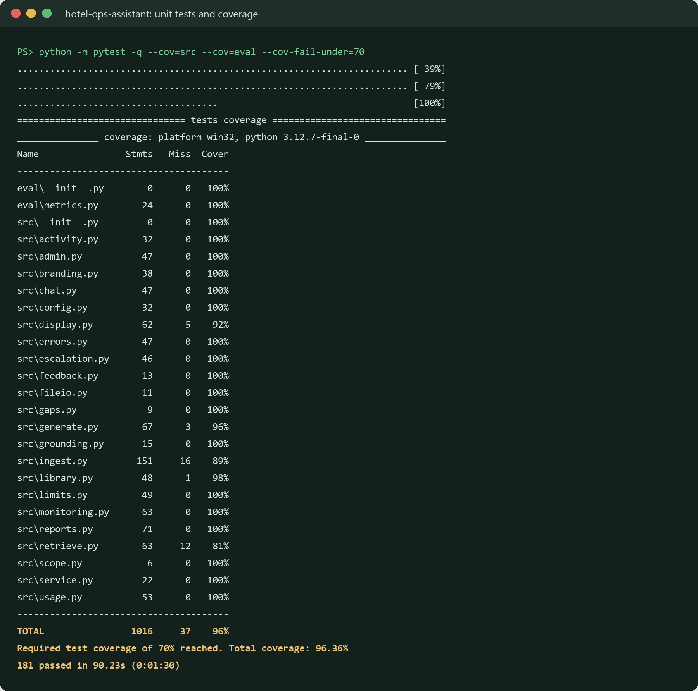
</details>

CI runs on the light install (no PyTorch): lint, format check, `pip-audit`, tests with a 70% minimum coverage, and a keyword-only retrieval regression gate (fails below 85%). Dependabot opens weekly update pull requests. Before release, a scripted Playwright QA pass clicked through every public page in light and dark mode at laptop and phone width (251 checks: links, text, limits, errors, admin lockout, console errors).

## Security and privacy

Only synthetic policy documents are indexed; no guest or payment data. Each question and its top 5 passages are sent to the API; earlier turns never are. Secrets stay in `.env` or Streamlit secrets. Questions are logged as typed (git-ignored, newest 5,000 entries), so the app asks visitors not to enter guest details; redaction comes in Project 4. Output is escaped, the public demo has per-session and daily caps, and the Admin page is password-protected with a lockout. [SECURITY.md](SECURITY.md) has the threat model and the OWASP Top 10 for LLM Applications mapping.

## Limitations and roadmap

- **Spanish and other languages:** the embedding model is English-only (documented, not fixed).
- **OCR** for scanned documents (currently flagged, not read).
- **Live demo is keyword-only** on the free tier; the jacket and Spanish questions need hybrid.
- **The eval questions were written by the same person who wrote the documents**, which flatters the scores; held-out questions are on the [validation checklist](docs/VALIDATION_CHECKLIST.md).
- **Word-list grading** has known false positives; an LLM judge calibrated against human labels is **Project 3**.
- **Sign-in with roles, personal-data redaction, durable logs and monitoring:** **Project 4**.
- **Project 2** uses this assistant as a tool in a guest-email agent.

## Documentation

| Document | Contents |
|---|---|
| [ARCHITECTURE.md](docs/ARCHITECTURE.md) | System and request-flow diagrams, components, scaling path |
| [BUSINESS_CASE.md](docs/BUSINESS_CASE.md) | Value model, assumptions, policy gaps, pilot plan, KPIs, risks |
| [DECISIONS.md](docs/DECISIONS.md) | 38 decisions with context, decision, tradeoff and result |
| [ENGINEERING_LOG.md](docs/ENGINEERING_LOG.md) | What broke and how it was fixed, in my own words |
| [DEMO_SCRIPT.md](docs/DEMO_SCRIPT.md) | Word-for-word 2-minute walkthrough |
| [VALIDATION_CHECKLIST.md](docs/VALIDATION_CHECKLIST.md) | Steps that need a person: measured baseline, held-out questions |
| [SECURITY.md](SECURITY.md) | Data handling, threat model, OWASP LLM Top 10 mapping |
| [CONTRIBUTING.md](CONTRIBUTING.md) | Workflow, commit style, how to add documents, properties and eval questions |
| [CHANGELOG.md](CHANGELOG.md) | Version history |

## How this was built

Built with AI-assisted development (Claude Code). I defined the requirements and standards, made the product and design decisions, reviewed the changes, and tested the app myself, including finding several bugs through manual testing.

## Author

**Vamsi Alla** · AI Engineer · I turn messy business problems into AI systems that work in production: measured, deployed and owned end to end.

🌐 [Portfolio](https://vamsialladev.github.io) · 💼 [LinkedIn](https://www.linkedin.com/in/vamsi-alla/) · 🐙 [GitHub](https://github.com/vamsialladev) · ✉️ vamsialla.dev@gmail.com

## License

[MIT](LICENSE) © 2026 Vamsi Alla
