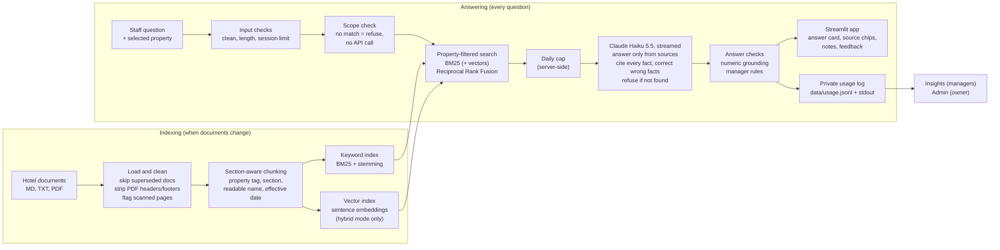
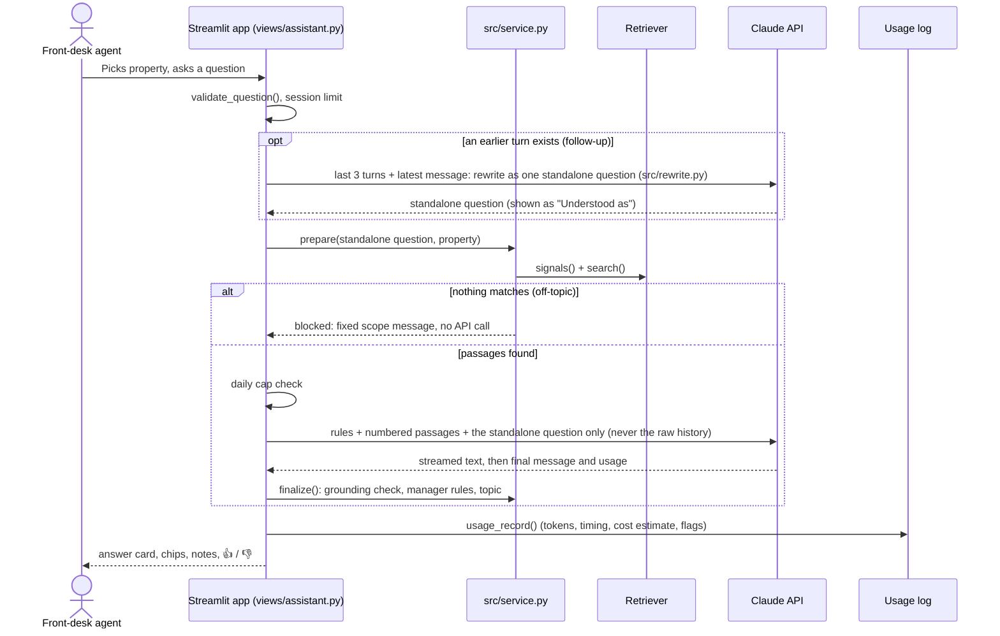

# Architecture

## System overview

## Request flow

## Pages
| Page | Audience | What it shows |
|---|---|---|
| Assistant (`views/assistant.py`) | Front-desk staff | Chat per property, streamed cited answers, source chips, manager notes, copy, feedback |
| Insights (`views/insights.py`) | Hotel managers | Questions, helpful rate, 👎 reasons, top topics, refused questions as policy gaps, known gaps |
| Document library (`views/library.py`) | Managers, engineers | Every document's status and passage count; data-quality issues |
| How it works (`views/how_it_works.py`) | Recruiters, engineers | Results read from the newest eval report, running retrieval mode, architecture, model comparison, safety |
| Disclaimer and privacy (`views/about.py`) | Everyone | What the demo is, how data is handled |
| Admin (`views/admin.py`) | Owner only | Usage, cost estimate, latency, refusals, grounding flags, cap use, recent retrievals; password-gated |

## Components
| Component | File | Responsibility |
|---|---|---|
| Config | `src/config.py` | Paths, model, limits, prices; all overridable by environment variables or Streamlit secrets |
| Branding | `src/branding.py`, `branding.toml` | Product name, colors, logo, property names, sample questions (white-label) |
| Ingestion | `src/ingest.py` | Load, clean, chunk, name and tag documents; build the keyword and vector indexes |
| Retrieval | `src/retrieve.py` | Property filter, BM25 + vector search, rank fusion, scope signals |
| Scope check | `src/scope.py` | Decide whether a question can be answered from the documents before calling the API |
| Generation | `src/generate.py` | Prompt, streaming Claude call, citation parsing, refusal detection |
| Service | `src/service.py` | One question end to end: prepare, finalize, usage record |
| Grounding | `src/grounding.py` | Numbers in the answer must appear in cited sources (used by app and eval) |
| Escalation | `src/escalation.py` | "Check with a manager" rules, each quoting its document |
| Policy gaps | `src/gaps.py` | Gaps found in the documents, shown to managers |
| Chat state | `src/chat.py` | Input validation, per-property histories, feedback reasons |
| Limits | `src/limits.py` | Daily cap across all visitors (atomic file counter) |
| Usage and feedback | `src/usage.py`, `src/feedback.py` | JSON Lines logs with retention; stdout logging without question text |
| Errors | `src/errors.py` | Map API errors to one friendly message; private detail with secrets masked and a plain likely cause (authentication, credit, model, rate limit, network) |
| Guidance and recovery | `src/assist.py`, `src/intents.py`, `src/suggestions.py`, `data/suggestions.toml` | Greetings answered instantly; curated follow-ups, "Did you mean" and popular questions; topics generated from the indexed documents (no API call) |
| Reload guard | `codeguard.py` | After an in-place update, drops changed `src/`, `views/` and `eval/` modules so they're imported fresh together; the index rebuilds when the documents' fingerprint changes |
| Secrets check | `src/secrets_check.py`, `scripts/make_secrets.py` | Report each secret as set or missing (never a value), log missing ones at startup, build `.streamlit/secrets.toml` from `.env` |
| Admin gate | `src/admin.py` | Constant-time password check, failure delay, lockout, sign out, idle auto-lock |
| Monitoring | `src/monitoring.py` | Health, threshold warnings, recent errors, CSV export for the Admin page |
| Request log | `src/requestlog.py` | Outcome and refusal reason for every record (older ones included), the Admin list, filters, row selection, request details with "not recorded" for missing fields, JSON/JSONL downloads |
| Safe file writes | `src/fileio.py` | Retries Windows file-sharing collisions so logs and the counter never crash a page |
| Error boundary | `views/components.py` | Wraps every page and callback: friendly message, error recorded, no crash screen |
| Display | `src/display.py` | HTML and `$` escaping, source chips, badges, tables, bar lists |
| Library, activity, reports | `src/library.py`, `src/activity.py`, `src/reports.py` | Document inventory; Insights and Admin aggregates; parsing saved eval reports and the business case |
| Pages | `app.py`, `views/` | Thin Streamlit pages; no logic beyond wiring |
| CLI | `ask.py` | Quick command-line questions |
| Evaluation | `eval/run_eval.py`, `eval/metrics.py`, `eval/questions.jsonl` | 54 questions; strict retrieval, answers, grounding, refusals, scope, escalation, latency, cost |
| Tests | `tests/` | 307 tests, including every page rendered with `AppTest`; no API key or PyTorch needed |

## Request log record
One JSON line per request in `data/usage.jsonl` (schema version 2, written by `service.usage_record`, masked by
`usage.redact`). Ratings in `data/feedback.jsonl` carry the same `request_id`.

| Field | Meaning |
|---|---|
| `schema_version` | 2 (records without it are version 1: no answer, citations, follow-ups or outcome) |
| `request_id` (and `turn_id`) | Short unique ID; feedback links to it |
| `time` | UTC, ISO 8601 |
| `session_id` | Anonymous random ID per browser session, not tied to a person |
| `property`, `question`, `source` | Which hotel, the question as typed, and how it was asked (typed, example, follow-up…) |
| `outcome` | `answered`, `refused`, `off_topic`, `greeting`, `error` or `cap` |
| `refusal_reason` | `not_in_documents`, `off_topic`, `daily_cap` or `session_cap` |
| `answer`, `citations`, `follow_ups` | Full answer text, the passages it cited (`n`, source, section), the questions offered under it |
| `retrieved` | Every passage retrieved: source, section, score, `cited` |
| `model`, `mode`, `ttft_s`, `total_s` | Model (none when no API call), search mode, first-word and total time |
| `tokens_in`, `tokens_out`, `cost_usd` | Token counts and the estimated cost from the configured prices |
| `grounding_flag`, `ungrounded`, `escalations` | Numbers not found in the cited sources; manager notes |
| `error`, `error_message` | Error code and a short masked message (no traceback, no secrets) |

## Deployment modes
| | Streamlit Community Cloud (live demo) | Docker (local or always-on host) |
|---|---|---|
| Install | `requirements.txt` only | `requirements-hybrid.txt` with CPU PyTorch |
| Retrieval | Keyword-only (BM25) | Hybrid (BM25 + embeddings) |
| Measured | 96% retrieval, 96% answers, p95 2.71s, $0.17 / 1,000 | 98% retrieval, 98% answers, p95 2.42s, $0.19 / 1,000 |
| Memory | about 100 MB for the retriever | about 600 MB with the embedding model |
| Logs | Reset when the app restarts | Persist for the container's life (mount a volume to keep them) |

## Key design choices
See [DECISIONS.md](DECISIONS.md) for all 50. In short:
- **Hybrid search**, because staff use exact terms (prices, airport codes) and loose phrasing; keyword-only where memory is tight.
- **Property filter before search**, because a correct answer from the wrong hotel is still wrong.
- **Refuse rather than guess, and refuse off-topic questions for free.**
- **Each question answered on its own**, so every answer stands on the documents.
- **Checks after generation** (grounding, manager rules) are deterministic code, not more model calls.
- **Small, fast model, chosen by measurement** (Haiku 5.5: equal quality, a fifth of the cost).

## Scaling path
| Today (2 properties) | At 100+ properties |
|---|---|
| Index stored in local files | Managed vector database (e.g. pgvector) with property metadata filters |
| Rebuild the whole index | Incremental re-indexing when a document changes, with screening for injected instructions |
| Single Streamlit app | API service + staff app, single sign-on, roles and per-property access (Project 4) |
| Local JSON Lines logs | Durable, access-controlled log store with retention policy and PII redaction (Project 4) |
| Admin page | Metrics dashboard: usage, latency, cost, refusal rate, alerts (Project 4) |
| Word-list grading | LLM judge calibrated against human labels, 100+ questions, regression gates (Project 3) |
