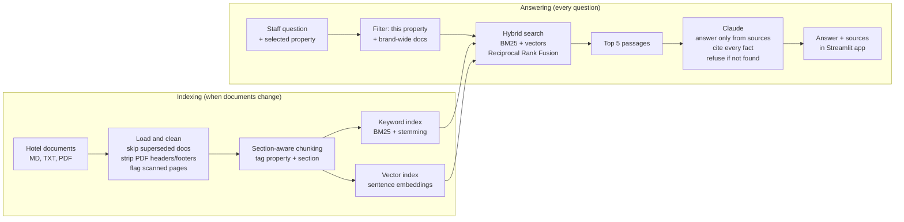
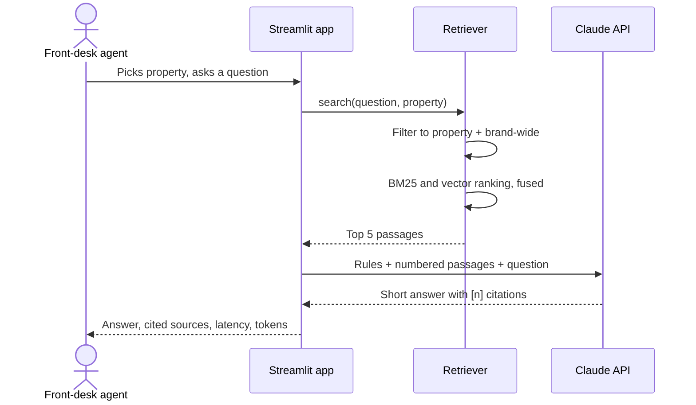

# Architecture

## System overview

## Request flow

## Components
| Component | File | Responsibility |
|---|---|---|
| Config | `src/config.py` | Paths, model names, top-k; all overridable by environment variables |
| Ingestion | `src/ingest.py` | Load documents, clean, chunk, tag, embed, save index |
| Retrieval | `src/retrieve.py` | Property filter, BM25 + vector search, rank fusion |
| Generation | `src/generate.py` | Prompt, Claude call, citation parsing, refusal detection |
| Web app | `app.py` | Staff interface with sources and debug view |
| CLI | `ask.py` | Quick command-line questions |
| Evaluation | `eval/run_eval.py`, `eval/metrics.py` | 37 questions; strict retrieval, citation and grounding checks; reports; CI threshold |
| Feedback | `src/feedback.py` | Logs staff 👍 / 👎 for weekly review |
| Tests | `tests/` | Ingestion, isolation, stemming, citation parsing |

## Key design choices
See [DECISIONS.md](DECISIONS.md) for the full log. In short:
- **Hybrid search**, because staff use exact terms (prices, airport codes) and loose phrasing.
- **Property filter before search**, because a correct answer from the wrong hotel is still wrong.
- **Refuse rather than guess**, because a confident wrong answer causes guest conflicts.
- **Small, fast model**, because a guest is waiting.

## Scaling path
| Today (2 properties) | At 100+ properties |
|---|---|
| Index stored in local files | Managed vector database (e.g. pgvector) |
| Rebuild the whole index | Incremental re-indexing when a document changes |
| Single Streamlit app | API service + staff app, with single sign-on per property |
| No access control | Role-based access per property |
| Basic logging | Metrics dashboard: usage, latency, cost, refusal rate (Project 4) |
